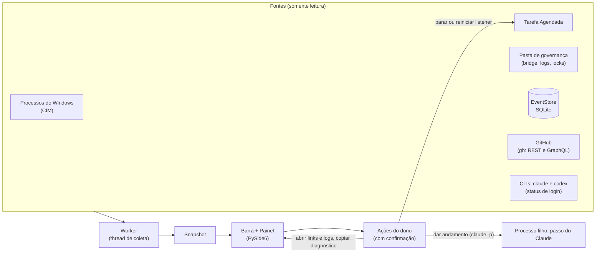

# Documentação do Agent Bar

> **Histórico (2026-11-22):** este documento descreve peças do orquestrador legado FP-057/FP-060 (listener/event bridge, laço de revisão do Codex, chip GPT, passo "Dar andamento", `AGENT_BAR_GOV_DIR`) que **saíram** do Agent Bar. O estado atual está no README e em [`docs/audit/legacy-cleanup-2026-11-22.md`](audit/legacy-cleanup-2026-11-22.md).

Esta pasta documenta **tudo** o que o Agent Bar faz: de onde vêm os dados, como cada estado é decidido, o que cada botão executa, quais garantias de segurança existem (e quais testes as sustentam), e por que cada decisão de projeto foi tomada (ADRs).

> Convenção: os nomes de arquivos, funções e variáveis aparecem em `código`. Tudo o que está aqui foi verificado contra o código e os testes deste repositório (145 testes). Onde algo **não** existe ou é limitado, está dito explicitamente em [limitações e roadmap](limitacoes-e-roadmap.md).

## Por onde começar

| Quero... | Leia |
| --- | --- |
| entender o que é e como as peças se encaixam | [Visão geral](architecture/01-visao-geral.md) |
| saber de onde vem cada dado e o que acontece quando falha | [Fontes de dados](architecture/02-fontes-de-dados.md) |
| entender o ciclo de coleta, threads, caches e TTLs | [Ciclo de coleta](architecture/03-ciclo-de-coleta.md) |
| ver as estruturas de dados (Snapshot, AgentStatus...) | [Modelo de dados](architecture/04-modelo-de-dados.md) |
| saber **por que** uma bolinha tem aquela cor | [Estados dos agentes](reference/estados-dos-agentes.md) |
| saber o que cada parte da interface faz | [Interface](reference/interface.md) |
| entender a fila de PRs e a classificação | [Fila de PRs](reference/fila-de-prs.md) |
| entender o botão "Dar andamento" e o terminal embutido | [Passo do Claude](reference/passo-claude.md) |
| entender como o EventStore é lido | [Observabilidade do EventStore](reference/observabilidade-eventstore.md) |
| configurar (variáveis, `settings.json`, arquivos) | [Configuração](reference/configuracao.md) |
| rodar/diagnosticar pela linha de comando | [CLI](reference/cli.md) |
| avaliar riscos e garantias | [Segurança](seguranca.md) |
| entender os testes e como rodá-los | [Testes](testes.md) |
| saber o que falta | [Limitações e roadmap](limitacoes-e-roadmap.md) |
| decifrar um termo | [Glossário](glossario.md) |
| entender o raciocínio por trás do desenho | [ADRs](adr/README.md) |

## Mapa em uma imagem

## Documentos históricos neste repositório

- [`agent_bar.md`](agent_bar.md): documento original da FP-058 (barra do listener). Mantido por histórico; **a referência atual é esta pasta**.
- [`FP-061_agent_bar_control_center.md`](https://github.com/Plan2Space/engineering-specs/blob/40b76f9ce10ab7e9a51e2a1e03495a9cd1ba2b72/agent-bar/FP-061_agent_bar_control_center.md): especificação da evolução FP-061 (central de observabilidade).
- [`reports/fp061/`](reports/fp061/README.md): evidência visual (capturas *offscreen* de fixture) da FP-061.
