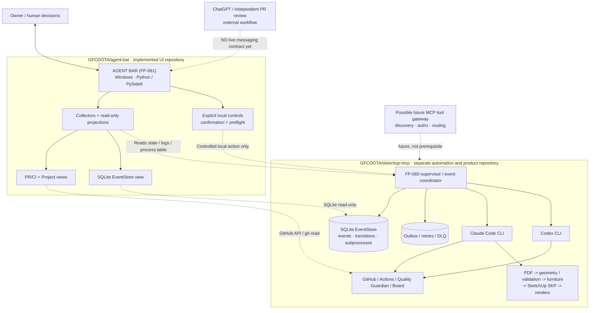

# Architecture map — Agent Bar and SketchUp MCP

> Status: **documentation of the current design and proposed integration**, based on `GFCDOTA/agent-bar` `develop` inspected on 2026-11-18. This document is **not** an end-to-end production validation. The implementation of the orchestrator resides in the separate `GFCDOTA/sketchup-mcp` repository; statements about it here are integration contracts and architectural context, not a fresh audit of that repository.
>
> **Repository boundary:** `agent-bar` is the Windows **user interface / observer**, not the orchestrator. `sketchup-mcp` contains the automation, engineering workflows and SketchUp modeling pipeline.

## 1. End-to-end overview

Solid arrows describe conceptual responsibilities; dotted arrows describe observational or **proposed** integration. The diagram is explanatory, not evidence that every path has passed a live E2E test.

## 2. What actually exists in agent-bar develop

| Area | Current implementation / evidence in this repository | Important limit |
| --- | --- | --- |
| Windows UI | `agent_bar/app.py`, `window.py` (PySide6), collapsed / expanded / full operations view | Desktop usability is not established merely by offscreen tests. |
| Collector snapshot | `collectors.py`, `models.py` read process state, listener heartbeat, logs and GitHub | Missing/unverifiable sources must display unknown/unavailable, never success. |
| EventStore observer | `observability.py` reads an existing version-1 SQLite schema with `mode=ro` and `PRAGMA query_only=ON` | Does **not** create DB/schema, mutate leases, deliver outbox, or become another worker. |
| Operational dashboard | `operations_view.py` shows timeline, queue, runs, failures, outbox, metrics and terminal excerpts | Open subprocess record is **not** proof the process is alive. |
| Local controls | `controls.py` and UI include confirmation-controlled listener operations and a one-step `claude -p` action | No automated merge/push or `--execute` should be attributed to the Agent Bar; controls must respect preflight and `AGENT_BAR_OBSERVE_ONLY=1`. |
| Launch | `launchers/run_agent_bar.ps1` starts `python -m agent_bar.app` in the project environment | Desktop shortcut / installation is machine-local; repository presence alone does not prove one exists. |
| Tests | `tests/test_agent_bar*.py` and fixtures | A green unit/offscreen test is not a verified Windows desktop E2E. |

Source details: [README](../README.md), [Agent Bar guide](agent_bar.md), [FP-061 specification](https://github.com/Plan2Space/engineering-specs/blob/40b76f9ce10ab7e9a51e2a1e03495a9cd1ba2b72/agent-bar/FP-061_agent_bar_control_center.md).

## 3. Responsibility boundaries

### Layer A — Agent Bar (FP-061)

**What it does:** shows agents, listener, GitHub / PR status, Project backlog, SQLite-derived operational information and errors; offers a small set of explicit local controls. It is a **control/observation surface**, not the source of truth.

**What it must not do:** invent liveness from an installed binary, infer GPT integration from a logo, bypass branch protection, approve its own work, silently execute unsafe commands, or write directly to the EventStore.

### Layer B — Automation / FP-060 (separate repository)

The event coordinator / supervisor owns execution, durable event state, outbox, recovery, concurrency and worker lifecycle. The Agent Bar must use **authoritative read-only observations** and explicitly authorized command interfaces. Whether each FP-060 subsystem is production-ready requires checking the current `sketchup-mcp` source and its E2E evidence.

### Layer C — Agents and governance

Claude Code and Codex are CLI workers / tools in the automation architecture; GPT independent review is a distinct human-mediated or separately integrated workflow, **not currently a live Agent Bar worker**. GitHub Actions, Quality Guardian and branch policy remain their own enforcement points. CI passing is not a substitute for substantive PR review. Approval and merging are distinct actions.

### Layer D — The actual product

All automation exists to improve the apartment-modeling delivery pipeline in `sketchup-mcp`: floorplan / PDF input, semantics / geometry and collision validation, furniture, `.skp` output, renders and visual cockpit. The Agent Bar is **not** itself the SketchUp geometry engine.

## 4. Current vs proposed capabilities

| Capability | Status in this repo (develop) | Next proof / integration |
| --- | --- | --- |
| PySide6 toolbar and panels | **Code present** | Open on actual Windows desktop, verify display/monitor behavior. |
| GitHub / Project observations | **Collector code present** | Validate authentication, errors, timestamps and real permissions. |
| Read-only EventStore projection | **Code present** | Verify against current FP-060 DB/schema and real traces. |
| `Dar andamento (Claude)` one-step subprocess | **Code present** | Verify confirmation, mission path, cancellation and isolation on Windows. |
| GPT agent connectivity/status | **Not integrated** | Define authenticated provenance and heartbeat/status contract. |
| GPT → Claude / Codex chat and decisions | **Not implemented** | Define durable message schema, idempotency, authorization, audit and UI. |
| Genuine live multi-agent orchestration | **Outside this repository** | Validate FP-060 separately, including process recovery and E2E. |
| MCP tool gateway inspired by Uber | **Proposal only** | Assess need for tool discovery, per-tool authz and routing *after* FP-060 stability. |
| Windows desktop shortcut | **Local setup, not verified here** | Test actual shortcut path, icon, restart and environment on owner's machine. |

## 5. Dataflow examples

**Observe a PR:** GitHub / workflow and bridge data → collector → snapshot → Agent Bar screen. On stale auth, missing checks or error, show unavailable/stale; never classify a PR as approved from green checks alone.

**Observe a task:** supervisor / SQLite writes real events → Agent Bar opens DB read-only → displays timeline, lease, outbox and logs. The UI must distinguish an event recorded in SQLite from a live OS process.

**Advance one step:** owner clicks `Dar andamento (Claude)` → confirmation and safety checks → UI starts a bounded `claude -p` step with configured mission → progress appears in read-only terminal → outcome shown. This path is separate from autonomous FP-060 orchestration and requires validation; it does not authorize merges.

**Future cross-agent message:** owner / GPT → authenticated command API (not currently present) → durable inbox or event → authorized worker → correlated reply → Agent Bar. Requires identity, authorization, deduplication, ordering / correlation, retries and audit. The mere existence of SQLite does **not** make chat functional.

## 6. Questions that should govern the next phase

1. Which **real** FP-060 events and heartbeats can be shown in the UI without guessing?
2. Is the standalone Agent Bar actually running from the Windows desktop shortcut in a tested user session?
3. Can we demonstrate one isolated end-to-end task from command to worker to persisted event and UI update?
4. What command types need explicit human authorization, and how is independent review protected?
5. Does a new gateway add value beyond the existing specific integrations, or merely duplicate them?

**Recommended sequence:** validate the current desktop app and data sources → finish and prove FP-060 integrations → define secure messaging and decisions → consider an MCP gateway only if demonstrably needed.

## 7. Naming / source of truth

- **Agent Bar, FP-061:** UI and its controls, in `GFCDOTA/agent-bar`.
- **FP-060:** orchestration and runtime in `GFCDOTA/sketchup-mcp`.
- **SketchUp MCP:** the modeling automation product, not interchangeable with a generic MCP gateway.
- **MCP gateway (possible future):** authorization/discovery/routing facade for tools; **not** a replacement for the EventStore or an implementation already shipped here.
