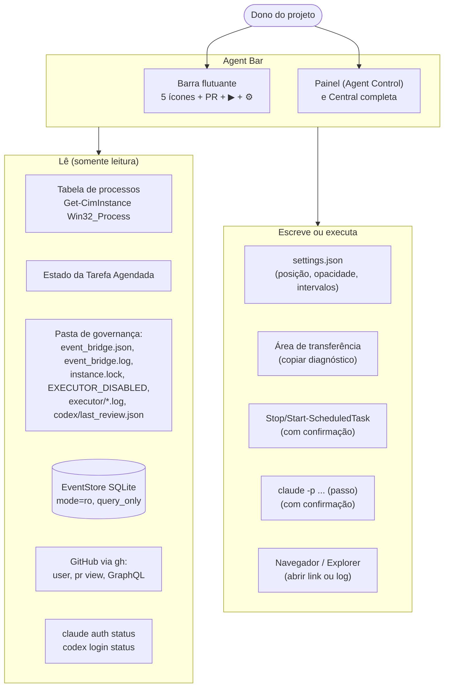
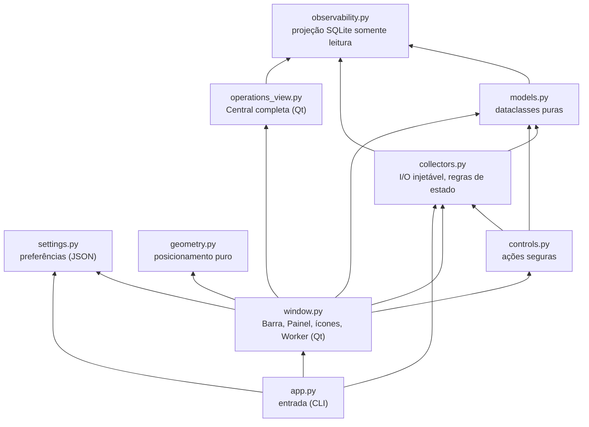
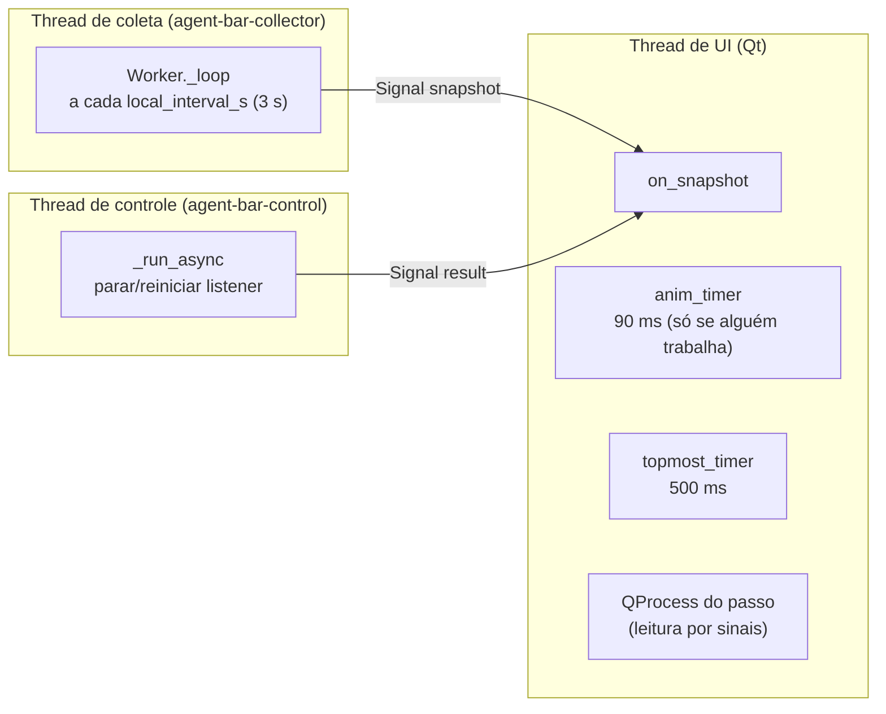
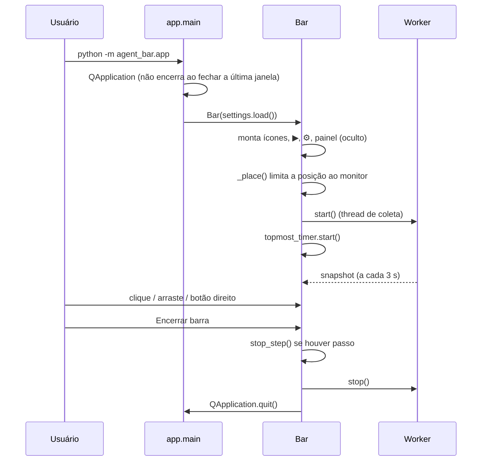

# Visão geral

> **Histórico (2026-11-22):** este documento descreve peças do orquestrador legado FP-057/FP-060 (listener/event bridge, laço de revisão do Codex, chip GPT, passo "Dar andamento", `AGENT_BAR_GOV_DIR`) que **saíram** do Agent Bar. O estado atual está no README e em [`docs/audit/legacy-cleanup-2026-11-22.md`](../audit/legacy-cleanup-2026-11-22.md).

## O que é

O Agent Bar é uma **barra flutuante do Windows** (PySide6/Qt) que responde, num relance, a quatro perguntas:

1. **Cada agente está conectado?** Claude Code, Codex, GPT, a automação (laço de revisão ou listener) e o GitHub.
2. **Alguém está trabalhando agora?** Quando sim, a bolinha do agente vira o **logo animado** dele.
3. **O que está acontecendo com os PRs?** Fila real dos PRs abertos, classificada pelo que precisa acontecer.
4. **Posso dar um empurrão?** Um botão (▶) roda **um passo** do Claude para corrigir achados de revisão, mostrando o progresso num terminal embutido (somente leitura).

Ele **observa**. Não faz merge, não faz push, não usa `--execute`, não altera arquivos de nenhum projeto. As únicas ações que têm efeito são as do dono, sempre com confirmação (parar/reiniciar o listener em DRY_RUN e dar andamento).

## Princípios de projeto

| Princípio | O que significa na prática | ADR |
| --- | --- | --- |
| Observar, não orquestrar | A barra não é um segundo orquestrador; só lê o que os outros já gravam | [0001](../adr/0001-somente-observacao-com-uma-unica-acao.md) |
| Cor é conexão, logo é trabalho | Uma regra só para as bolinhas | [0002](../adr/0002-cor-igual-conexao-logo-igual-trabalho.md) |
| Ausência de dado nunca é sucesso | Sem dado = cinza ou "indisponível", nunca verde nem zero inventado | [0008](../adr/0008-ausencia-de-dado-nunca-e-sucesso.md) |
| UI nunca espera I/O | Toda coleta roda em outra thread, com caches | [0003](../adr/0003-coleta-fora-da-thread-de-ui-com-cache-ttl.md) |
| Falhar fechado | Na dúvida, recusa a ação e diz o motivo | [0001](../adr/0001-somente-observacao-com-uma-unica-acao.md), [0008](../adr/0008-ausencia-de-dado-nunca-e-sucesso.md) |

## Contexto: o que a barra toca

## Camadas e módulos

O pacote `agent_bar/` é dividido por responsabilidade. A regra de dependência aponta para dentro: `models` não conhece nada; `collectors` e `observability` não conhecem Qt; só `window` e `operations_view` conhecem Qt.

| Módulo | Responsabilidade | Qt? | I/O externo? |
| --- | --- | --- | --- |
| `models.py` | `Level`, `AgentStatus`, `Snapshot`, `PrQueue`, `GroupedEvent`... e o texto de diagnóstico | não | não |
| `observability.py` | `collect_observation`: lê o EventStore em `mode=ro` e devolve `Observation` | não | SQLite (leitura) |
| `settings.py` | `Settings`, `load`, `save`, `clamp` | não | arquivo JSON |
| `geometry.py` | `Rect`, `pick_screen`, `clamp_window`, `fit_height`, `place_below` | não | não |
| `collectors.py` | todos os coletores, regras de estado, caches (`GithubCache`), login em cache, fila de PRs | não | processos, arquivos, `gh`, CLIs |
| `controls.py` | parar/reiniciar listener, abrir URL/arquivo, comando e formatação do passo, `kill_tree` | não | PowerShell, `taskkill` |
| `operations_view.py` | os 8 cartões e o terminal da Central completa | sim | não |
| `window.py` | `Worker`, `StatusIcon` e logos, `TitleBar`, `Details` (painel), `Bar` (barra) | sim | via `controls`/`collectors` |
| `app.py` | `python -m agent_bar.app` | só ao abrir a GUI | não |

> **Por que `collectors` recebe tudo por função injetável?** Para os testes substituírem processos, `gh`, relógio e CLIs sem tocar no sistema (ver [Testes](../testes.md)).

## Threads e temporizadores

| Quem | Quando roda | O que faz |
| --- | --- | --- |
| `Worker._loop` (thread `agent-bar-collector`) | a cada `local_interval_s` (padrão 3 s; 2–30) ou imediatamente em `refresh()` | `collect_snapshot` e emite o sinal `snapshot` |
| `Bar.anim_timer` | 90 ms, **só** enquanto algum ícone está em "trabalhando" | avança a fase da animação dos logos |
| `Bar.topmost_timer` | 500 ms, sempre | reafirma `HWND_TOPMOST` da barra e do painel aberto (Win32), para a barra de tarefas não cobri-los |
| `_run_async` (thread `agent-bar-control`) | por clique em Parar/Reiniciar listener | executa a operação lenta fora da UI e emite o resultado |
| `QProcess` do passo | por clique em ▶ / Dar andamento | processo filho do painel; a saída chega por sinais Qt, sem thread extra |

## Ciclo de vida da aplicação

## Onde cada coisa mora (resumo)

- **Regras de estado:** `collectors.py` (`collect_claude`, `collect_codex`, `collect_listener`, `collect_github`, `review_loop`).
- **Cores e logos:** `window.py` (`COLORS`, `AGENT_COLOR`, `LOGO_PAINTERS`, `StatusIcon`).
- **Fila de PRs:** `collectors.py` (`PR_QUEUE_QUERY`, `classify_pr`, `collect_pr_queue`) e `window.py` (`queue_html`).
- **Passo do Claude:** `controls.py` (`progress_command`, `format_stream_line`, `kill_tree`) e `window.py` (`Bar.action_progress` e família).
- **Segurança/guardas testadas:** [Segurança](../seguranca.md).
