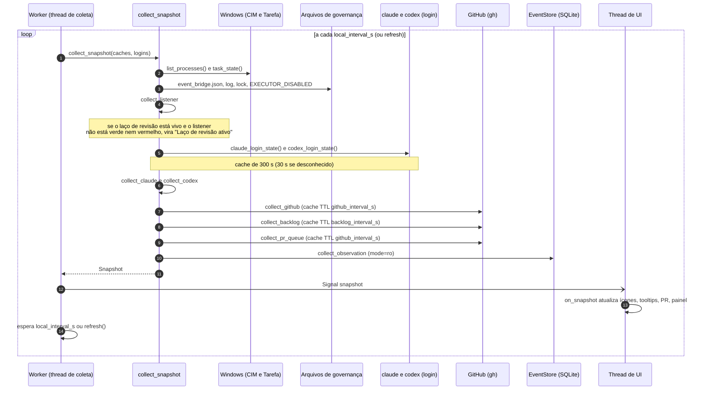
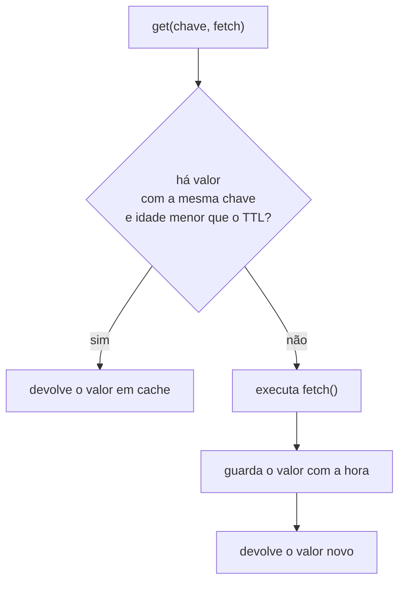
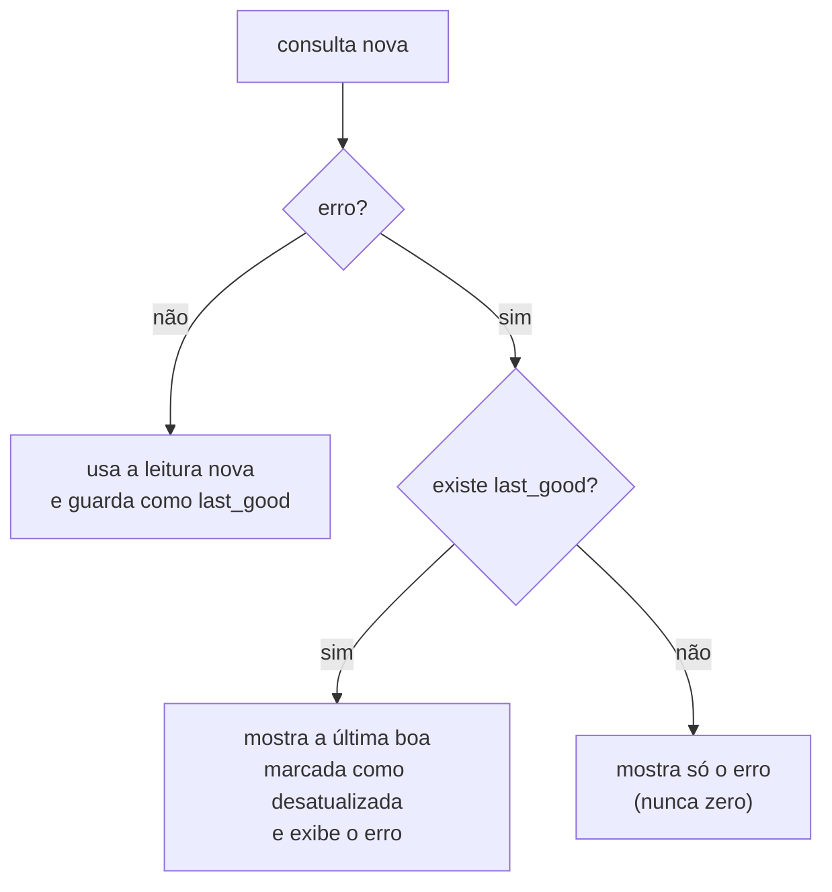
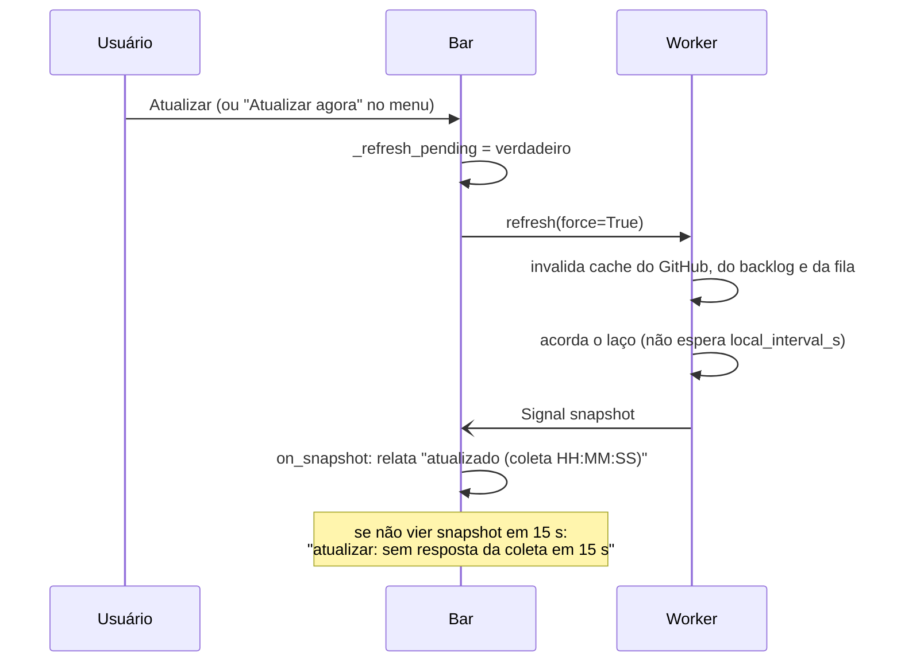

# Ciclo de coleta

> **Histórico (2026-11-22):** este documento descreve peças do orquestrador legado FP-057/FP-060 (listener/event bridge, laço de revisão do Codex, chip GPT, passo "Dar andamento", `AGENT_BAR_GOV_DIR`) que **saíram** do Agent Bar. O estado atual está no README e em [`docs/audit/legacy-cleanup-2026-11-22.md`](../audit/legacy-cleanup-2026-11-22.md).

A interface **nunca** faz I/O. Quem coleta é o `Worker`, numa thread própria (`agent-bar-collector`), que produz um `Snapshot` imutável por ciclo e o entrega à UI por sinal Qt. Esta página descreve o ciclo, os caches e o que acontece nas bordas (erro, atualização forçada, fechamento).

## Sequência de um ciclo

Observações:

- O `Snapshot` é montado **inteiro** a cada ciclo; nada é atualizado "aos pedaços". Se uma consulta falha, o campo correspondente carrega o erro, e o resto do `Snapshot` continua válido.
- Qualquer exceção dentro do ciclo é capturada em `Worker._loop` (`traceback.print_exc`), a coleta continua no próximo ciclo e **a UI nunca cai** por erro de coleta.
- A ordem importa em dois pontos: o **listener** é calculado antes do **laço de revisão** (que pode sobrescrevê-lo) e o **laço de revisão** entra como raiz de vínculo para o Codex (filho do laço = "Revisando PR (vinculado)").

## Caches (`GithubCache`)

| Cache | Chave | TTL (padrão) | Faixa permitida | Tratamento de erro |
| --- | --- | --- | --- | --- |
| Status do GitHub | `pr<N>` (muda com o PR atual) | `github_interval_s` = 60 s | 15–600 s | o resultado (inclusive o vermelho de erro) fica em cache pelo TTL |
| Backlog do Project | `backlog` | `backlog_interval_s` = 300 s | 60–3600 s | mantém a **última leitura boa** e a marca "desatualizado desde HH:MM:SS", mostrando também o erro |
| Fila de PRs | `pr_queue` | `github_interval_s` = 60 s | 15–600 s | mantém a **última fila boa** e a marca "desatualizado desde ...; erro: ..." |
| Login do Claude / Codex | `claude` / `codex` (módulo) | 300 s se conhecido, 30 s se `None` | fixo | `None` (desconhecido) nunca vira "logado" |

> A chave do cache do status do GitHub inclui o número do PR: se o "PR atual" muda, ele é consultado de novo imediatamente.

### "Última leitura boa" (backlog e fila de PRs)

Regra de honestidade: **lista vazia ≠ "sem PRs"** e **zero ≠ "sem itens"**. Quando a leitura falha, a interface diz que falhou.

## Atualização forçada (botão "Atualizar" e ações)

- `force=True` invalida **somente** os três caches de GitHub. O cache de **login** (CLIs) **não** é invalidado (é de módulo e tem TTL próprio).
- Depois de parar/reiniciar o listener (`_run_async`) e ao terminar um passo, a barra pede `refresh` para o estado refletir o resultado.

## Tempos e limites do ciclo

| Item | Valor |
| --- | --- |
| Intervalo local (processos e arquivos) | `local_interval_s` = 3 s (faixa 2–30) |
| Timeout da tabela de processos | 15 s |
| Timeout da Tarefa Agendada | 15 s |
| Timeout padrão do `gh` | 60 s |
| Timeout dos logins (`claude auth status`, `codex login status`) | 25 s |
| Timeout de leitura do EventStore (SQLite) | 0,25 s |
| Parada da thread de coleta ao fechar | `join` de até 5 s |

## Fechamento

`Bar.close_app`: encerra o passo em andamento (se houver) → `Worker.stop` (sinaliza e acorda a thread) → fecha o painel → `QApplication.quit`. Fechar o **painel** (✕ ou `Esc`) **não** faz nada disso: só esconde a janela.
