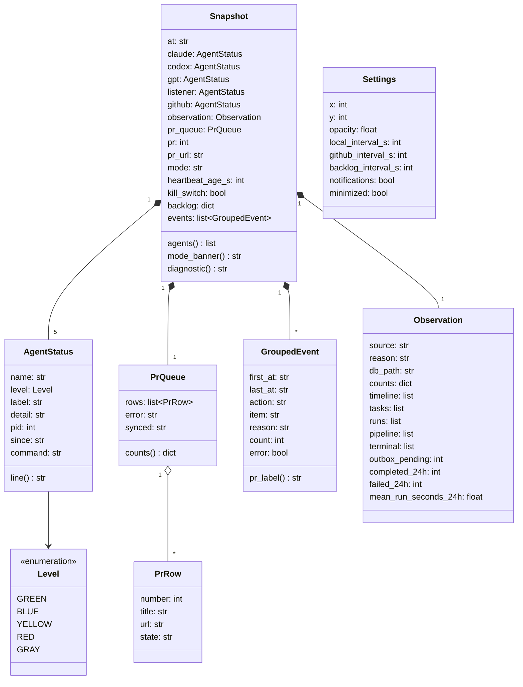

# Modelo de dados

As estruturas abaixo são `dataclass` em `models.py` (sem Qt, sem I/O) e `observability.py`. O `Snapshot` é o único objeto que atravessa da thread de coleta para a UI.

## Diagrama

## `Level` (a semântica das cores)

| Valor | Cor (hex) | Significado na barra | Significado no código |
| --- | --- | --- | --- |
| `GREEN` | `#3ddc84` | **conectado** | operacional |
| `GRAY` | `#8a8f98` | **desconectado / sem integração** | desligado, desconhecido, não configurado ou não integrado (**nunca** sucesso) |
| `YELLOW` | `#ffc233` | **atenção** | aguardando, ocioso, dependência pendente, estado ambíguo, limite de uso |
| `RED` | `#ff4d4f` | **erro** | erro ou interrupção inesperada |
| `BLUE` | `#4aa8ff` | **trabalhando** → vira **logo animado** | executando tarefa |

`BLUE` nunca aparece como bolinha azul na barra: a barra troca a bolinha pelo logo animado do agente (ver [Interface](../reference/interface.md)). No painel, o texto do agente usa o glifo `✻` na cor do próprio agente.

## `AgentStatus`

| Campo | Para quê |
| --- | --- |
| `name` | um de `Claude`, `Codex`, `GPT`, `Listener`, `GitHub` (as chaves dos ícones) |
| `level` | cor/estado (acima) |
| `label` | texto curto (aparece no tooltip e no painel), por exemplo "Conectado", "Sem login", "Limite de uso" |
| `detail` | **uma linha de evidência** de onde veio o dado |
| `pid`, `since`, `command` | processo atribuído (quando houver); `command` já vem redigido |
| `line()` | `Nome: label pid N - detalhe`, usada nos tooltips e no diagnóstico |

## `Snapshot`: campos relevantes

| Campo | Origem | Observação |
| --- | --- | --- |
| `claude`, `codex`, `gpt`, `listener`, `github` | coletores | `gpt` é fixo: cinza "Indisponível" (sem fonte de estado) |
| `observation` | `collect_observation` | projeção do EventStore (somente leitura) |
| `pr_queue` | `collect_pr_queue` | fila de PRs; começa como `PrQueue(error="nao coletada")` |
| `pr`, `pr_url` | `current_pr` + `collect_github` | PR **atual do listener** (não a fila inteira) |
| `mode` | bridge + log | `DRY_RUN`, `EXECUTE` ou `indisponivel` (`ambiguo` se bridge e log discordam) |
| `heartbeat_age_s` | `last_poll` do bridge | segundos desde o último ciclo do listener |
| `kill_switch` | `EXECUTOR_DISABLED` | `None` quando não observável |
| `concurrent_instances`, `lock_holder`, `lock_status` | processos e lock | detecta instâncias concorrentes e lock órfão |
| `backlog`, `backlog_error`, `backlog_synced` | `collect_backlog` | contagens por coluna do Project |
| `events` | `event_bridge.log` agrupado | eventos consecutivos idênticos viram uma linha com contagem |
| `work` | fila do bridge | "TRABALHANDO (executando uma tarefa)" ou "apenas monitorando" |
| `executor_summary`, `review_ref`, `log_path` | bridge e logs | resumo de fila/tentativas/execuções 24 h; review/SHA atual; último log |

### `Snapshot.diagnostic()`
Texto que o botão "Copiar diagnóstico" põe na área de transferência: uma linha por agente (com `cmd` e `inicio` quando houver), modo, trabalho, PR atual, review/SHA, checks, heartbeat, kill switch, instâncias, lock, executor, backlog, último erro, log, até 10 eventos recentes e o resumo do EventStore. **Sem segredos**: só estado observado (os comandos já passaram por `short_cmd`).

## `PrQueue` e `PrRow`

- `PrRow.state` é um de `pronto`, `corrigir`, `conflito`, `ci`, `aguarda`, `rascunho` (ordem em `PR_STATE_ORDER`: o que pede ação vem primeiro).
- **Invariante:** `error` preenchido significa "a leitura falhou". Uma lista vazia **não** significa "sem PRs".
- `counts()` devolve as contagens na ordem canônica, só dos estados presentes.

## `Observation` e entradas

`Observation.source` é `real`, `demonstração` ou `indisponível`; `reason` explica. `timeline`, `tasks`, `runs` e `pipeline` são listas de `TimelineEntry`, `TaskEntry`, `RunEntry`. Campos `messages_status`, `decisions_status` e `heartbeats_status` carregam textos fixos dizendo que esses canais **não existem** (ver [Observabilidade do EventStore](../reference/observabilidade-eventstore.md)).

## `Settings`

Ver [Configuração](../reference/configuracao.md) (faixas e padrões). Persistida em JSON fora do repositório.
