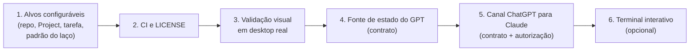

# Limitações e roadmap

Esta página lista, com honestidade, o que o Agent Bar **não** faz ou faz de forma limitada hoje, e o que está planejado. Nada aqui é escondido na interface: quando algo não existe, a barra mostra "indisponível".

## Limitações conhecidas

### Escopo e acoplamento (herdados da extração do `sketchup-mcp`)

| Limitação | Efeito | Onde |
| --- | --- | --- |
| Repositório alvo **fixo**: `GFCDOTA/sketchup-mcp` (PR atual e fila de PRs) | em outro projeto, a fila e o GitHub mostram dados do repositório errado | `collect_github`, `collect_pr_queue` |
| Project do backlog **fixo**: organização `GFCDOTA`, número 1, colunas fixas | idem | `collect_backlog` |
| Nome da Tarefa Agendada **fixo**: `sketchup-mcp event bridge` | estado/parar/reiniciar só valem para essa tarefa | `TASK_NAME` |
| Padrão do laço de revisão **fixo**: `tools.orchestration.pr_lifecycle run` | só reconhece esse processo | `LOOP_RE` |
| Missão e prompt do passo falam em "FP-060" | texto específico do projeto de origem | `progress_command` |
| URLs dos botões Repositório e Project #1 fixas | | `controls.py` |
| Só Windows | processos via CIM/PowerShell; `HWND_TOPMOST` via Win32; fora do Windows a tabela de processos é `None` | `list_processes`, `raise_topmost` |

### Funcionalidades que não existem

| Item | Situação |
| --- | --- |
| **Canal ChatGPT → Claude Code** (enviar mensagens sem copiar e colar) | **não existe**. Exige contrato persistido, API de comandos e autorização. O painel diz "Mensagens entre agentes indisponíveis: sem contrato persistido" |
| **Estado do GPT** | sem fonte; o chip fica cinza "Indisponível" |
| **Decisões humanas** e **heartbeats por worker** | sem contrato; textos fixos "indisponíveis" |
| **Terminal interativo** | o terminal embutido é **somente leitura** (acompanhar e parar); não dá para digitar no passo |
| **Merge pela barra** | não existe **de propósito** (decisão do dono) |
| **Logos oficiais** | só desenhos próprios; é possível substituir por PNGs |
| **Streaming real do EventStore** | a Central completa atualiza por polling a cada coleta |

### Qualidade e processo

| Item | Situação |
| --- | --- |
| **Sem CI** neste repositório | a suíte roda localmente (145 testes); falta workflow do GitHub Actions |
| **Sem LICENSE** | decisão pendente do dono |
| **Validação visual em desktop real** | as capturas são *offscreen* de fixture; o veredito visual é do dono |
| `default_gov_dir` e `workspace_root` por convenção de pastas | funcionam, mas dependem do layout; use `AGENT_BAR_GOV_DIR` / `AGENT_BAR_WORKSPACE` para fixar |
| Código morto: constante `_UNUSED_JQ` em `collectors.py` | resíduo da versão anterior do backlog (sem efeito) |
| Cache do login no módulo (`_LOGIN_CACHE`) | não é invalidado por "Atualizar" (só expira por TTL) |
| Logos personalizados lidos **uma vez** por execução | reiniciar a barra para trocar |

### Comportamentos que merecem atenção
- **"PR sem checks" aparece com nível âmbar e rótulo "Conectado"** no chip GitHub (o nível é a informação confiável; o rótulo é um resíduo de redação).
- **"pronto para você mergear" é heurística**, não garantia de que a proteção de branch permite o merge.
- O chip **GitHub** descreve o **PR atual do listener**; se não há listener/`event_bridge.json`, ele mostra "sem PR em andamento" mesmo com dezenas de PRs abertos na fila.

## Roadmap

Ordem sugerida (do que mais reduz atrito ao que mais amplia):

| # | Item | Resultado esperado | Dependências |
| --- | --- | --- | --- |
| 1 | **Alvos configuráveis** (`AGENT_BAR_REPO`, projeto, nome da tarefa, regex do laço, missão e prompt) | a barra serve a qualquer projeto sem editar código | nenhuma |
| 2 | **CI + LICENSE** | testes a cada push; termos de uso claros | decisão do dono (licença) |
| 3 | **Validação visual em desktop real** | veredito do dono sobre densidade, navegação e acessibilidade | nenhuma |
| 4 | **Estado do GPT** | chip do GPT deixa de ser fixo | contrato de fonte persistida |
| 5 | **Canal ChatGPT → Claude Code** | enviar mensagens sem copiar e colar | contrato persistido, API de comandos, autorização e proveniência |
| 6 | **Terminal interativo** (opcional) | digitar no passo | modo de entrada do `claude` e modelo de permissão definidos |
| 7 | **Invalidar o cache de login em "Atualizar"** | refletir um login recém-feito sem esperar o TTL | nenhuma |
| 8 | **Notificação de "limite de uso" com a hora do reset** | avisar quando o Codex volta | ler a hora do reset do log do laço |

> O item 5 é a motivação original da FP-061 ("Agent Bar / Taskbar"): ver [`specs/FP-061_agent_bar_control_center.md`](specs/FP-061_agent_bar_control_center.md). Ele está **fora** do que a barra faz hoje.

## Como propor mudanças
Toda decisão estrutural deve virar um [ADR](adr/README.md). Comportamento novo precisa de teste (red → green) e de atualização da página de referência correspondente.
