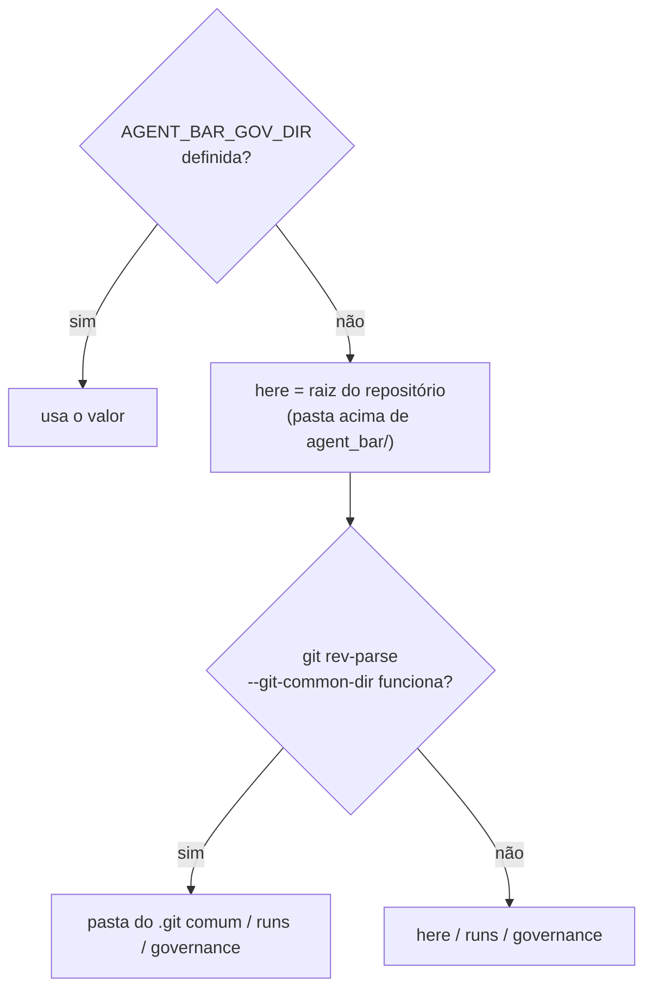

# Configuração

Tudo é opcional: sem nenhuma configuração a barra abre e mostra o que conseguir observar (o que faltar aparece como "indisponível"). Existem duas camadas: **variáveis de ambiente** (de onde ler e como agir) e `settings.json` (preferências da janela).

## Variáveis de ambiente

| Variável | Padrão | Para quê |
| --- | --- | --- |
| `AGENT_BAR_GOV_DIR` | `<raiz do repositório>/runs/governance` (ou, se a raiz for um checkout git, a pasta `runs/governance` ao lado da pasta `.git` comum) | pasta de **governança** do orquestrador observado: `event_bridge.json`, `event_bridge.log`, `event_executor.instance.lock`, `EXECUTOR_DISABLED`, `executor/*.log`, `codex/last_review.json` |
| `EVENT_STORE_DB_PATH` | `<AGENT_BAR_GOV_DIR>/event_store.db` | banco SQLite do EventStore (lido em `mode=ro`) |
| `AGENT_BAR_HARNESS_LOG` | (sem padrão) | log do coordenador/laço de revisão, usado como **fallback** do terminal da Central completa |
| `AGENT_BAR_MISSION` | `<workspace>/ops/launchers/fp060-passo.md` | arquivo `.md` da **missão** do botão "Dar andamento" |
| `AGENT_BAR_WORKSPACE` | primeira pasta acima do pacote com `ops/launchers`; senão o diretório atual | pasta de trabalho (cwd) do passo |
| `AGENT_BAR_SETTINGS` | `%APPDATA%\agent_bar\settings.json` (ou `~/agent_bar/settings.json` sem `APPDATA`) | caminho do arquivo de preferências |
| `AGENT_BAR_ICONS` | `%APPDATA%\agent_bar\icons` | pasta de logos próprios (`claude.png`, `codex.png`, `gpt.png`, `listener.png`, `github.png`) |
| `AGENT_BAR_OBSERVE_ONLY` | desligado | com `1`, desativa **todos** os controles (parar/reiniciar listener, dar andamento, ▶) |
| `AGENT_BAR_DEMO` | desligado | com `1`, rotula o EventStore lido como "DEMONSTRAÇÃO" |
| `AGENT_BAR_BOARD` | `rebuild` | `rebuild` = Plan2Space Project #2 (`PVT_kwDOFV8G784BsjNn`). `legacy` = board antigo `GFCDOTA` Project #1, inteiro (org, número e colunas dele), marcado **LEGADO** na tela e nunca misturado com o rebuild |
| `AGENT_BAR_ORG` | `Plan2Space` | org do GitHub da fila de PRs (todos os repos dela) e do Project. Nome fora da regra de login do GitHub é recusado e cai no padrão |
| `AGENT_BAR_PROJECT` | `2` | número do Project (v2). Valor não inteiro cai no padrão, com aviso |
| `AGENT_BAR_COLUMNS` | `Backlog,Ready,In Progress,Review,Blocked,Done` | colunas do board, em ordem. Status fora delas é contado à parte, não some |
| `AGENT_BAR_RUNS_DIR` | (sem padrão: **SEM FONTE**) | pasta de execuções do motor: `runs/<run_id>/manifest.json` (S00-02 C3/C10) ou `artifacts/<room>/<run_id>/run_manifest.json` (layout real do `sketchup-mcp-next`), lida para o card "Execuções do motor" |
| `AGENT_BAR_BENCHMARK_DIR` | (sem padrão: **SEM FONTE**) | pasta `benchmark/` do `agent-runtime` (ou a pasta acima dela), ex.: uma cópia via `git archive <sha> benchmark`. Lê `comparison.json` e `<backend>/runs/*/result.json` (`benchmark_result` 1.x; outro major é recusado por arquivo). Sem `comparison.json` legível: **INDISPONÍVEL**, nenhum número |
| `AGENT_BAR_BENCHMARK_COMMIT` | (não informado) | commit do `agent-runtime` de onde a cópia veio, mostrado na tela. Sem ele, a tela diz "commit de origem não informado" |
| `AGENT_BAR_APPROVERS` | (vazio: ninguém aprova pela barra) | logins aceitos como aprovadores na tela de aprovação humana (S00-14), separados por vírgula. Ver [aprovacao-humana.md](aprovacao-humana.md) |
| `AGENT_BAR_REVIEWER` | `fmmodesto` | login do agente revisor cuja recomendação aparece em "Precisa de você". Ver [precisa-de-voce.md](precisa-de-voce.md) |
| `QT_QPA_PLATFORM` | do Qt | `offscreen` nos testes e na geração de capturas |

O board é lido **no momento da consulta**: nome, URL, id, `Task ID` e `Status` de cada item, 100 por página até o fim. Falha de auth, falta de acesso, erro GraphQL ou resposta com menos itens que o `totalCount` aparecem como **INDISPONÍVEL** com o motivo. A barra nunca recorre a números antigos ou ao cache como fallback.

> O `gh` e os CLIs `claude`/`codex` são achados **pelo PATH**. Não há variável para apontar outro caminho.

### Resolução de `AGENT_BAR_GOV_DIR`



Isso faz a barra, quando executada a partir de um *worktree*, ler a pasta do checkout **principal** (a que o listener usa).

## `settings.json`

Gravado em `%APPDATA%\agent_bar\settings.json` (ou em `AGENT_BAR_SETTINGS`), fora do repositório. Escrita **atômica** (grava um `.tmp` e troca). Arquivo ausente, corrompido ou com campos desconhecidos **não derruba**: usa o padrão e ignora o que não conhece. Todos os valores numéricos são **limitados** à faixa abaixo ao carregar e ao salvar.

| Campo | Padrão | Faixa | Para quê |
| --- | --- | --- | --- |
| `x`, `y` | ausente | — | posição da barra (gravada ao soltar o arrasto) |
| `opacity` | 0,88 | 0,3–1,0 | opacidade da janela da barra |
| `local_interval_s` | 3 | 2–30 | intervalo da coleta local (processos e arquivos) |
| `github_interval_s` | 60 | 15–600 | TTL dos caches de GitHub (PR atual e fila de PRs) |
| `backlog_interval_s` | 300 | 60–3600 | TTL do cache do Project (consulta mais cara) |
| `notifications` | `false` | — | aviso na bandeja quando um agente fica vermelho |
| `minimized` | `false` | — | barra reduzida a um quadrado 44×44 |

Exemplo:

```json
{
 "x": 1808,
 "y": 2959,
 "opacity": 0.88,
 "local_interval_s": 3,
 "github_interval_s": 60,
 "backlog_interval_s": 300,
 "notifications": false,
 "minimized": false
}
```

> No Windows PowerShell 5.1, `Set-Content -Encoding utf8` grava **com BOM**, e o `json.loads` da barra rejeita o arquivo (a barra volta ao padrão). Grave sem BOM (por exemplo, `[System.IO.File]::WriteAllText(..., (New-Object System.Text.UTF8Encoding($false)))`).

## Valores fixos no código (não configuráveis hoje)

| Valor | Onde | Observação |
| --- | --- | --- |
| Nome da Tarefa Agendada `sketchup-mcp event bridge` | `TASK_NAME` | usado em estado, parar e reiniciar |
| Repositório do PR atual e da fila: `GFCDOTA/sketchup-mcp` | `collect_github`, `collect_pr_queue` | |
| Project do backlog: organização `GFCDOTA`, número 1 | `collect_backlog` | colunas fixas: Ready, In Progress, GPT Review, Blocked, Done |
| Padrão do laço de revisão: `tools.orchestration.pr_lifecycle run` | `LOOP_RE` | linha de comando do processo |
| Heartbeat velho: 600 s | `STALE_HEARTBEAT_S` | o listener faz ciclo a cada ~120 s |
| URLs dos botões Repositório e Project #1 | `controls.py` | |

Ver [Limitações e roadmap](../limitacoes-e-roadmap.md) para a intenção de torná-los configuráveis.

## Arquivos lidos e escritos

| Arquivo | Lê | Escreve |
| --- | --- | --- |
| `settings.json` | sim | sim (posição, notificações, minimizado) |
| pasta de governança (bridge, logs, lock, kill switch) | sim | **nunca** |
| banco do EventStore | sim (`mode=ro`) | **nunca** |
| logs de execução (stdout/stderr registrados) | sim (fim, limitado) | **nunca** |
| `icons/*.png` | sim | nunca |
| arquivo de missão | sim (o Claude o lê; a barra só confere que existe) | nunca |
