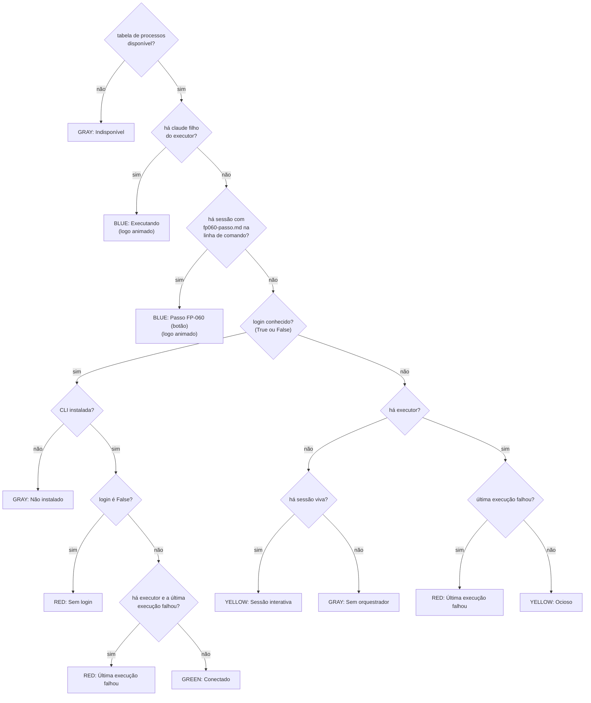
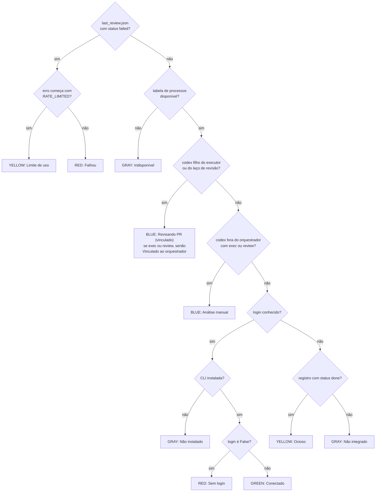
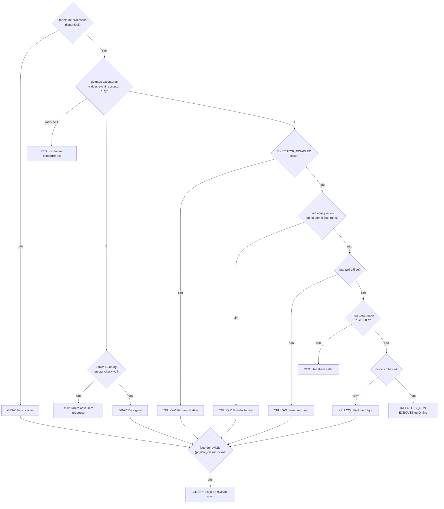

# Estados dos agentes

Esta página responde: **por que a bolinha de cada agente está daquela cor?** As regras estão em `collectors.py` e são avaliadas **em ordem de prioridade** (a primeira que casa vence). Para a semântica geral das cores, ver [Modelo de dados](../architecture/04-modelo-de-dados.md#level-a-semântica-das-cores) e [ADR 0002](../adr/0002-cor-igual-conexao-logo-igual-trabalho.md).

## A regra única

| O que você vê na barra | Significa |
| --- | --- |
| bolinha **verde** | conectado |
| bolinha **cinza** | desconectado, sem CLI, sem integração ou sem dado (**nunca** é sucesso) |
| bolinha **âmbar** | atenção |
| bolinha **vermelha** | erro |
| **logo animado** do agente | trabalhando agora |

Internamente "trabalhando" é `Level.BLUE`; a interface troca a bolinha pelo logo.

---

## Claude (`collect_claude`)

**Entradas:** tabela de processos, raízes do executor (`listener_roots`), CLI instalada?, login (`True`/`False`/`None`), último log do executor.

Classificação dos processos `claude`/`claude.exe`:

- **filho do executor:** descendente (por PPID) de uma raiz do executor.
- **auxiliar do app Desktop:** linha de comando casa `--type=`, `AnthropicClaude` ou `--startup` (não conta como execução).
- **sessão:** qualquer outro `claude` (por exemplo, o Claude Code interativo).
- **passo do botão:** sessão cuja linha de comando contém `fp060-passo.md` (o passo que a barra inicia).

| Estado | Nível | Quando | Detalhe típico |
| --- | --- | --- | --- |
| Indisponível | cinza | tabela de processos não observável | "tabela de processos nao observavel" |
| Executando | azul | claude descendente do executor | "filho do executor, ha Ns" |
| Passo FP-060 (botão) | azul | sessão com `fp060-passo.md` | "sessao aberta pelo botao, ha Ns" (+ "sem orquestrador" se não há executor) |
| Não instalado | cinza | login conhecido, mas `claude` fora do PATH | "CLI nao encontrada" |
| Sem login | vermelho | `claude auth status` diz `loggedIn: false` | "rode `claude auth login`" |
| Última execução falhou | vermelho | há executor e o log mais recente do executor tem falha | nome do log |
| **Conectado** | **verde** | logado (login `True`) | "logado (claude.ai)" + sessões vivas |
| Sessão interativa | âmbar | login desconhecido, sem executor, mas há sessão | "Claude Code vivo, sem vinculo com o executor" |
| Sem orquestrador | cinza | login desconhecido, sem executor, sem sessão | "CLI instalada/nao instalada" |
| Ocioso | âmbar | login desconhecido, com executor, sem falha | "ultima execucao: ..." |

> O ramo "login desconhecido" (`None`) existe por segurança: sem saber se está logado, a barra **não** pinta verde. Em uso normal a barra consulta o login (cache 300 s), então o ramo verde/vermelho é o que vale.

---

## Codex (`collect_codex`)

**Entradas:** registro `codex/last_review.json`, processos, raízes (executor **e** laço de revisão), CLI instalada?, login.

Processo "Codex": nome `codex`/`codex.exe`, ou `node` cuja linha de comando casa o *wrapper* do Codex. **Trabalho** = linha de comando com `exec` ou `review` (o app Codex aberto, `app-server`, **não** conta como trabalho).

| Estado | Nível | Observações |
| --- | --- | --- |
| Limite de uso | âmbar | a conta do revisor atingiu o limite de uso; **volta sozinha** no reset. Não é erro nem desconexão ([ADR 0013](../adr/0013-limite-de-uso-do-revisor-e-atencao-nao-erro.md)) |
| Falhou | vermelho | falha real registrada pelo revisor |
| Revisando PR (vinculado) / Vinculado ao orquestrador / Análise manual | azul | trabalhando (logo animado) |
| **Conectado** | **verde** | logado (ChatGPT). O detalhe inclui "app aberto (pid N)" se houver processo do app, o último parecer (se `done`) e o aviso "revisor automatico NAO operacional (E2E Claude<->Codex nao comprovado)" |
| Sem login / Não instalado | vermelho / cinza | |
| Ocioso / Não integrado | âmbar / cinza | só no ramo "login desconhecido" |

> O aviso "revisor automático NÃO operacional" é **texto fixo** do detalhe: a barra não afirma que o E2E Claude↔Codex está comprovado.

---

## GPT (fixo)

Sempre **cinza "Indisponível"**: "Nenhuma fonte de estado GPT contratada pelo Harness". Não existe fonte de estado para o GPT; a barra **não finge** uma conexão. É o único agente que não tem lógica de coleta.

---

## Listener / Automação (`collect_listener` + sobrescrita pelo laço de revisão)

O chip **Listener** representa a automação da FP-060. Existem dois "motores" possíveis: o **listener** (`event_executor run`) e o **laço de revisão** (`pr_lifecycle run`).

**Modo (`mode`)** é derivado de `event_bridge.json` e do último registro do log:

| bridge.mode | último log `execute` | Resultado |
| --- | --- | --- |
| `execute` | verdadeiro | `EXECUTE` |
| `dry-run` | falso | `DRY_RUN` |
| `execute`/`dry-run` | discordam | `ambiguo` |
| ausente | presente | pelo log |
| presente | ausente | pelo bridge |
| nenhum | nenhum | `indisponivel` |

**Sobrescrita pelo laço de revisão:** se um `pr_lifecycle run` está vivo e o estado do listener **não** é verde nem vermelho (por exemplo, "Desligado"), o chip passa a **verde "Laço de revisão ativo"**, com o detalhe `pr_lifecycle run (pid N, há Ns); listener FP-057 <estado do listener>`. O motivo: a automação viva da FP-060 é o laço de revisão; o listener antigo fica desligado de propósito, e mostrar "Desligado" enganaria. Vermelho (por exemplo, instâncias concorrentes) **não** é escondido por essa regra.

---

## GitHub (`collect_github`)

Refere-se ao **PR atual do listener** (o mais recente em andamento na fila do `event_bridge.json`), **não** à fila de PRs do painel.

| Condição | Nível | Rótulo |
| --- | --- | --- |
| `gh api user` falha | vermelho | "Sem conexão/auth" |
| sem PR em andamento | verde | "Conectado" (detalhe: "login X; sem PR em andamento") |
| `gh pr view` ilegível | âmbar | "PR ilegível" |
| algum check com falha (`FAILURE`, `CANCELLED`, `TIMED_OUT`, `ACTION_REQUIRED`, `STARTUP_FAILURE`) | vermelho | "Falha em checks" |
| algum check pendente | âmbar | "Checks pendentes" |
| review com `CHANGES_REQUESTED` | âmbar | "Review pede mudanças" |
| PR sem nenhum check | âmbar | "Conectado" (detalhe: "sem checks") |
| tudo ok (`SUCCESS`, `NEUTRAL`, `SKIPPED`) | verde | "Conectado" |

> Detalhe do texto: o resumo conta `ok / pendente(s) / falha(s)`. O caso "PR sem checks" usa o rótulo "Conectado" com nível âmbar: o nível é a informação confiável.

---

## Exemplo real (observado num dia de uso)

| Agente | Nível | Rótulo | Por quê |
| --- | --- | --- | --- |
| Claude | verde | Conectado | `claude auth status` → logado; sessão interativa viva |
| Codex | âmbar | Limite de uso | revisor suspenso até o reset da conta |
| GPT | cinza | Indisponível | sem fonte de estado |
| Listener | verde | Laço de revisão ativo | `pr_lifecycle run` vivo; listener FP-057 desligado |
| GitHub | verde | Conectado | `gh` autenticado; sem PR do listener em andamento |

## Como o painel mostra cada agente

Cada linha: bolinha (ou glifo `✻` de trabalho na cor do agente) + **nome** + rótulo + `pid` (se houver), e embaixo o `detail` em cinza. O tooltip da barra mostra `Nome: rótulo pid N - detalhe` e o nome do nível (`conectado`, `trabalhando`, `atencao`, `erro`, `desconectado / sem integracao`).
