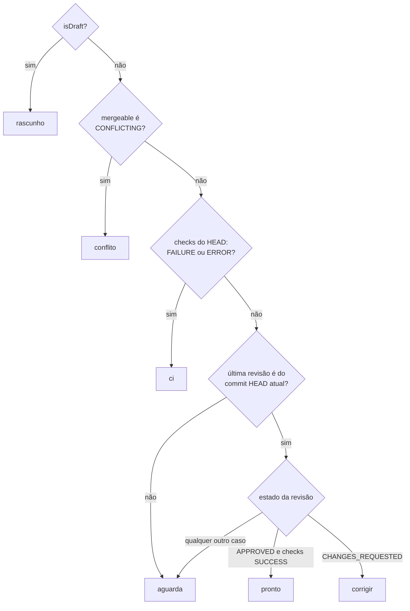

# Fila de PRs

O painel mostra a fila **real** dos PRs abertos do repositório, classificada pelo que precisa acontecer com cada um. A classificação usa **só fatos do GitHub** (nada é inferido ou inventado) e **nunca** dá a ideia de que a barra faz merge: ela só indica quando um PR **parece pronto para o dono mergear**.

## Como a fila é obtida

Uma consulta GraphQL por página (50 PRs), via `gh api graphql`, com cache de `github_interval_s` (60 s). O `gh` roda **sem** `GH_TOKEN`/`GITHUB_TOKEN` no ambiente (usa o login do próprio `gh`).

```graphql
query($owner:String!, $name:String!, $after:String) {
  repository(owner:$owner, name:$name) {
    pullRequests(states:OPEN, first:50, after:$after) {
      pageInfo { hasNextPage endCursor }
      nodes {
        number title url isDraft mergeable headRefOid
        reviews(last:1)  { nodes { state commit { oid } } }
        commits(last:1)  { nodes { commit { statusCheckRollup { state } } } }
      }
    }
  }
}
```

- `reviews(last:1)`: só a **última** revisão (de qualquer autor).
- `commits(last:1)`: só o **último commit** (o HEAD) e o resultado agregado dos checks dele.
- Paginação: segue `hasNextPage` até **4 páginas (200 PRs)**. Se ainda houver mais, a leitura é **recusada** com o erro "mais de 200 PRs abertos: contagem incompleta recusada" (nunca mostra uma contagem parcial como se fosse total).

## Classificação (`classify_pr`)

As regras são avaliadas **na ordem**; a primeira que casa vence.



| Estado | Rótulo no painel | Cor | Significa | Quem age |
| --- | --- | --- | --- | --- |
| `pronto` | "N pronto(s) para você mergear" | verde | aprovado **no HEAD atual** e checks `SUCCESS` | o dono (decide o merge) |
| `corrigir` | "N a corrigir" | âmbar | a última revisão, **no HEAD atual**, pede mudanças | quem corrige (por exemplo, o passo do Claude) |
| `conflito` | "N com conflito" | vermelho | `mergeable = CONFLICTING` | quem resolve o conflito |
| `ci` | "N com CI falhando" | vermelho | checks do HEAD em `FAILURE` ou `ERROR` | quem corrige o CI |
| `aguarda` | "N aguardando revisão" | azul claro | nunca revisado, **ou** commit novo depois da última revisão, **ou** CI pendente/ausente, **ou** revisão que não aprova nem pede mudanças | o revisor |
| `rascunho` | "N rascunho" | cinza | PR em rascunho | o autor |

### Regras finas (todas cobertas por testes)

- **Aprovação de outro commit não vale:** o `commit.oid` da revisão precisa ser igual ao `headRefOid` (comparação sem diferenciar maiúsculas).
- **Sem prova de CI não existe "pronto":** `APPROVED` com checks `PENDING`, `EXPECTED` ou sem nenhum check (`statusCheckRollup` nulo) cai em `aguarda`.
- **CI vermelho vence aprovação:** `APPROVED` + `FAILURE` é `ci`, nunca `pronto`.
- **`mergeable = UNKNOWN`** (o GitHub ainda calculando) **não** é conflito.
- **`CHANGES_REQUESTED` em commit antigo** (houve correção depois) é `aguarda`: a correção ainda não foi revisada.
- **Revisões que não aprovam nem pedem mudanças** (`COMMENTED`, `DISMISSED`) viram `aguarda`.

> **Atenção ao nome "pronto":** é uma heurística de evidência, não uma garantia de que o merge é permitido. A proteção de branch pode exigir revisores específicos, checks obrigatórios diferentes ou outras condições. A decisão e o merge são do dono; **a barra não tem botão de merge**.

## Ordenação e exibição

- A lista é ordenada por `PR_STATE_ORDER` = `pronto`, `corrigir`, `conflito`, `ci`, `aguarda`, `rascunho` (o que pede ação vem primeiro) e, dentro de cada estado, por número do PR.
- O painel mostra uma linha de cabeçalho com a contagem total e as contagens por estado (só dos estados presentes), e lista **até 6 PRs** dos estados que pedem ação (`pronto`, `corrigir`, `conflito`, `ci`), cada um como `• #N <situação> <título até 44 caracteres>` com **link** para o PR (abre no navegador).
- Títulos e URLs são escapados (HTML) antes de aparecer.

Exemplo de cabeçalho:

```
PRs 27 abertos · 7 a corrigir · 2 com conflito · 1 com CI falhando · 11 aguardando revisão · 6 rascunho
```

## Erros e dados desatualizados

| Situação | O que o painel mostra |
| --- | --- |
| falha na primeira leitura | `PRs indisponível: <erro técnico>` (nunca "0 abertos") |
| falha depois de uma leitura boa | a **última fila boa** + "(desatualizado desde HH:MM:SS; erro: ...)" |
| resposta ilegível / erros do GraphQL | erro explícito (`resposta do GraphQL ilegivel: ...` / `GraphQL: ...`) |
| mais de 200 PRs | erro "contagem incompleta recusada" |

## Limitações conhecidas

- O repositório consultado é fixo no código (`GFCDOTA/sketchup-mcp`): ver [Limitações e roadmap](../limitacoes-e-roadmap.md).
- Considera só a **última** revisão e só o **último** commit; não distingue revisores obrigatórios nem verifica a proteção de branch.
- Não há `reviewDecision` do GitHub na classificação (a regra é calculada localmente a partir da última revisão e dos checks).
