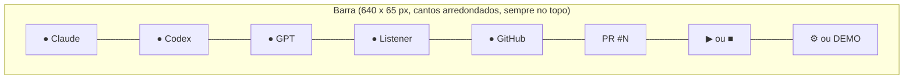
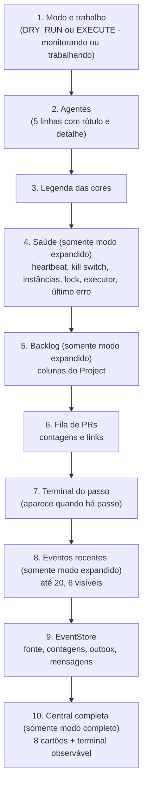
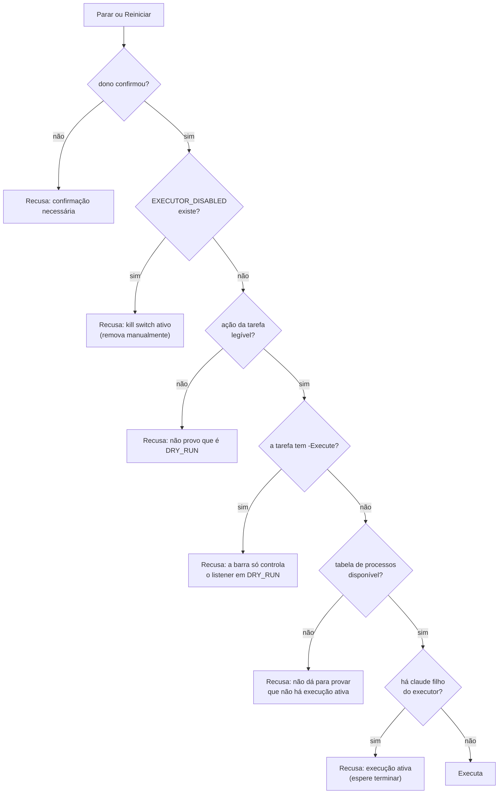

# Interface

> **Histórico (2026-11-22):** este documento descreve peças do orquestrador legado FP-057/FP-060 (listener/event bridge, laço de revisão do Codex, chip GPT, passo "Dar andamento", `AGENT_BAR_GOV_DIR`) que **saíram** do Agent Bar. O estado atual está no README e em [`docs/audit/legacy-cleanup-2026-11-22.md`](../audit/legacy-cleanup-2026-11-22.md).

A interface tem três peças que compartilham **o mesmo processo, o mesmo coletor e o mesmo `Snapshot`**:

1. a **barra** flutuante (`Bar`);
2. o **painel** (`Details`, título "Agent Control"), aberto por clique na barra;
3. a **Central completa**, que é o mesmo painel em modo largo (`Details.full_mode`, título "Harness Control Center").

## A barra

| Elemento | O que mostra | Interação |
| --- | --- | --- |
| **Ícone + nome** (5x) | bolinha na cor da conexão **ou** logo animado se o agente está trabalhando. Tooltip: `Nome: rótulo pid N - detalhe` e o nível | clique (sem arrastar) abre/fecha o painel |
| **PR #N** | PR **atual do listener** (ou "PR -"). Tooltip: resumo de checks | idem |
| **▶ / ■** | botão "Dar andamento" (▶) e "Parar passo" (■) | clique: mesmo fluxo do botão do painel ([Passo do Claude](passo-claude.md)). Desabilitado em modo somente leitura |
| **⚙ / DEMO** | engrenagem; vira `DEMO` quando o EventStore é uma fixture de demonstração. Tooltip: banner do modo, "trabalho" e último erro | idem |

### Aparência
- Fundo `rgba(20,20,24,225)`, borda `rgba(70,70,80,200)`, raio 16 px.
- Opacidade da **janela** = `settings.opacity` (padrão 0,88; faixa 0,3–1,0).
- Sem moldura (`FramelessWindowHint`), sempre no topo (`WindowStaysOnTopHint`) e janela do tipo `Tool` (não aparece na barra de tarefas).

### Mouse e teclado
| Ação | Efeito |
| --- | --- |
| clique esquerdo sem arrastar | abre/fecha o painel |
| arrastar com o botão esquerdo | move a barra; limitada ao **monitor inteiro** (margem 0); ao soltar, **salva** a posição em `settings.json`; o painel (se aberto e não movido por você) acompanha |
| clique direito | menu: **Expandir painel / Fechar painel**, **Atualizar agora**, **Notificações** (marcável), **Minimizar para ícone**, **Encerrar barra** |
| `Esc` (barra ou painel focado) | fecha o painel (não encerra a barra) |

**Notificações** (opcional, desligadas por padrão): quando um agente **passa para vermelho** vindo de um estado conhecido não vermelho, a bandeja do sistema mostra `Agent bar` + a linha do agente. Exige bandeja disponível.

**Minimizar para ícone:** reduz a barra a um quadrado 44×44 sem conteúdo (esconde ícones, nomes, PR, ▶ e ⚙) e esconde o painel. O mesmo item do menu restaura.

### Posição e geometria
- **Primeira execução (sem posição salva):** canto superior direito da área útil do monitor principal, a 24 px das bordas.
- **Posição salva:** é reaplicada **limitada ao monitor** (se o layout de monitores mudou e ela cairia fora da tela, volta para dentro).
- **Pode ficar sobre a barra de tarefas:** o limite da barra é o monitor inteiro (`screen_bounds`, margem 0), não a área útil. Só o **painel** respeita a área útil ([ADR 0006](../adr/0006-barra-sobre-a-barra-de-tarefas.md)).
- **Fica na frente:** a cada 500 ms reafirma `HWND_TOPMOST` (Win32 `SetWindowPos` com `NOMOVE|NOSIZE|NOACTIVATE`), porque a barra de tarefas do Windows volta à frente quando é clicada.
- **Mudança de monitor/resolução:** ao `geometryChanged` de qualquer tela, a barra é reposicionada dentro do monitor.

## Ícones e logos (`StatusIcon`)

Cada ícone tem 22×22 px. Estado **ocioso**: círculo preenchido (diâmetro ≈ 52% do ícone) na cor do nível. Estado **trabalhando**: o logo do agente, animado.

| Agente | Logo (desenhado com `QPainter`) | Cor | Animação por quadro (90 ms) |
| --- | --- | --- | --- |
| Claude | estrela de 8 pontas | `#d97757` | gira 7° e as pontas alternadas pulsam (`0,72 + 0,28·sen(0,4·fase)`) |
| Codex | balão arredondado com `>_` | `#7aa2ff` (texto `#0b1020`) | o cursor `_` pisca a cada 5 quadros |
| GPT | roseta de 6 pétalas | `#10a37f` | gira 3° |
| Listener | dois arcos de 110° | `#4aa8ff` | giram 18° |
| GitHub | anel com um ponto em órbita | `#e6e6e6` | o ponto orbita 16° |

- A animação roda **só enquanto algum ícone está em "trabalhando"** (o `anim_timer` liga e desliga sozinho): sem trabalho, sem custo de CPU.
- **Logos oficiais:** se existir `<agente em minúsculas>.png` (`claude.png`, `codex.png`, `gpt.png`, `listener.png`, `github.png`) na pasta de ícones (`AGENT_BAR_ICONS` ou `%APPDATA%\agent_bar\icons`), ele **substitui o desenho** e pulsa em opacidade (0,55 a 1,0). O arquivo é lido uma vez por execução (reinicie a barra para trocar) ([ADR 0011](../adr/0011-logos-desenhados-com-substituicao-por-png.md)).
- Os desenhos são aproximações próprias (não os logotipos oficiais).

## O painel ("Agent Control")

Largura 560 px (Central completa: 920 px). Tem **barra de título fixa** (30 px), **corpo com rolagem** e **rodapé fixo** com botões.

### Barra de título
| Botão | Efeito |
| --- | --- |
| arrastar a barra de título | move o painel; a partir daí ele fica **independente** da barra (`user_moved`) |
| **—** | recolhe o painel à barra de título (e restaura) |
| **□** | se recolhido, restaura; senão reajusta ao conteúdo e recoloca na tela |
| **✕** | fecha **somente o painel** (não para listener, Claude nem Codex) |
| clique direito | menu: Fechar painel, Recolher/restaurar, Encerrar barra |

### Corpo (ordem de cima para baixo)

| Seção | Conteúdo exato |
| --- | --- |
| Modo e trabalho | banner (`DRY_RUN — execução automática desligada` em âmbar, `EXECUTE — execução automática LIGADA` em vermelho, `modo indisponível` em cinza) + "trabalho" (`TRABALHANDO (executando uma tarefa)` ou `apenas monitorando`) |
| Agentes | por agente: bolinha/glifo, nome em negrito, rótulo, `pid`; abaixo o `detail` |
| Legenda | "conectado · desconectado / sem integração · atenção · erro · logo animado = trabalhando" |
| Saúde | heartbeat (s), kill switch (`ATIVO`/`inativo`/indisponível), instâncias do executor, status do lock, resumo do executor, último erro |
| Backlog | `Ready`, `In Progress`, `GPT Review`, `Blocked`, `Done` com a hora do último sync; em erro mostra "desatualizado desde HH:MM:SS" e o erro |
| Fila de PRs | ver [Fila de PRs](fila-de-prs.md) |
| Terminal do passo | saída do passo em curso, somente leitura, até 500 linhas; ver [Passo do Claude](passo-claude.md) |
| Eventos recentes | até 20 linhas agrupadas (`HH:MM:SS  AÇÃO  PR #N  ×contagem (início–fim)  motivo`); erros em vermelho e negrito; eventos que apareceram desde a coleta anterior em azul e negrito; **duplo clique** abre o log original |
| EventStore | `Event Store · REAL/DEMONSTRAÇÃO/INDISPONÍVEL`, contagens `PENDING/RUNNING/DLQ`, outbox, e a mensagem de que mensagens entre agentes **não existem** |

### Rodapé: botões

Grade de 4 colunas, mais o botão de modo em largura total.

| Botão | Ação | Guarda |
| --- | --- | --- |
| **Repositório** | abre a URL do repositório no navegador | só URLs `https://github.com/` |
| **Project #1** | abre o Project do GitHub | idem |
| **PR atual** | abre `pr_url` do PR atual | se não houver URL, informa "URL indisponível ou fora de github.com" (vermelho) |
| **Logs** | abre o último log (do executor; senão o do bridge) com o programa padrão do Windows | se não houver, informa "nenhum log encontrado" |
| **Copiar diagnóstico** | copia `Snapshot.diagnostic()` | lê a área de transferência de volta para provar que copiou |
| **Atualizar** | coleta imediata (invalida os caches de GitHub) | informa "atualizado (coleta HH:MM:SS)" ou "sem resposta em 15 s" |
| **Reiniciar DRY_RUN** | reinicia o listener **em DRY_RUN** pela Tarefa Agendada | confirmação + preflight (ver abaixo) |
| **Parar** | para o listener pela Tarefa Agendada | confirmação + preflight (ver abaixo) |
| **Dar andamento (Claude)** / **Parar passo** | roda/encerra **um passo** do Claude | confirmação; ver [Passo do Claude](passo-claude.md) |
| **Central completa ↗ / Painel expandido ↙** | alterna entre os dois modos | — |

A linha de **status** acima dos botões mostra o resultado da última ação (✓ verde / ✗ vermelho + hora).

### Preflight de Parar e Reiniciar (fail-closed)

- **Parar:** `Stop-ScheduledTask`; depois espera até 15 s o executor sumir e o lock ser liberado; se ainda estiver vivo, avisa "não reinicie".
- **Reiniciar:** se o executor antigo está vivo, para a tarefa e espera até 15 s; **só então** `Start-ScheduledTask`. Nunca cria uma segunda instância (respeita o `InstanceLock`).

### Modos do painel

| Modo | Largura | Mostra | Esconde |
| --- | --- | --- | --- |
| Expandido (padrão) | 560 px | saúde, backlog, fila de PRs, terminal, eventos, EventStore | Central completa |
| Completo ("Central completa") | 920 px | fila de PRs, terminal do passo, EventStore e os **8 cartões** + terminal observável | saúde, backlog, eventos |

Os 8 cartões da Central completa (`OperationsView`): **Timeline de eventos**, **Pipeline PR / CI**, **Fila e dependências**, **Workers e leases**, **Retries, falhas e DLQ**, **Decisões humanas**, **Conversas e mensagens**, **Produtividade · 24 h**; mais "Saída observável dos terminais · polling". Detalhes dos dados em [Observabilidade do EventStore](observabilidade-eventstore.md).

### Posição e tamanho do painel
- **Posição:** abaixo da barra se couber; senão acima; sempre dentro do monitor (área útil, margem 8 px). Enquanto você não o move, acompanha a barra.
- **Altura:** o conteúdo, limitado a 580 px no modo expandido e à área útil (menos 2×8 px) no modo completo; mínimo de 60 px; o excedente **rola por dentro**, com a barra de título e o rodapé sempre visíveis.
- **Abertura:** fade de 180 ms (de 35% a 100% de opacidade).
- **Título:** acrescenta " · DEMONSTRAÇÃO" quando o EventStore é fixture.

## Modo somente leitura (`AGENT_BAR_OBSERVE_ONLY=1`)
Desabilita **Parar**, **Reiniciar DRY_RUN**, **Dar andamento (Claude)** e o ▶ da barra (com tooltip explicando). As ações também recusam se chamadas por outro caminho ("instância FP-061 somente leitura: controle desativado"). Abrir links/logs e copiar diagnóstico continuam funcionando.
