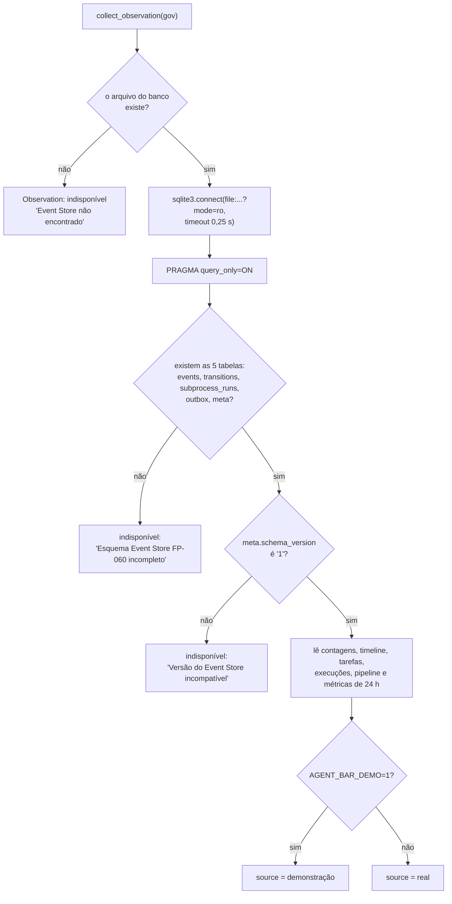
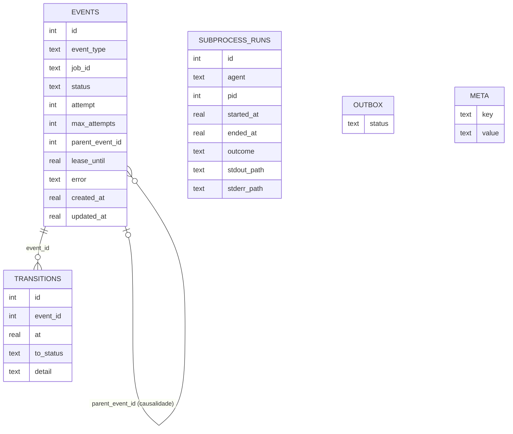

# Observabilidade do EventStore

A barra projeta o estado de um **EventStore SQLite** (o barramento de eventos durável da orquestração FP-060) em cartões e contagens. O acesso é **estritamente somente leitura** e **nunca cria nada** ([ADR 0004](../adr/0004-eventstore-somente-leitura-sem-criar-nada.md)).

## Como o banco é aberto

- **Caminho do banco:** `EVENT_STORE_DB_PATH`, senão `<pasta de governança>/event_store.db`.
- **Nunca** instancia a classe `EventStore` do projeto: o construtor dela cria tabelas e liga o modo WAL. A barra abre o arquivo por conta própria, com URI `mode=ro` e `PRAGMA query_only=ON`; a conexão é fechada ao fim de cada coleta.
- **Falhas** (`OSError`, `sqlite3.Error`, `ValueError`) viram `Observation` indisponível com o motivo `Event Store indisponível: <Tipo>: <mensagem>`. Nada é criado, nada é reparado.
- **Sem interpretação por tentativa:** uma versão diferente de `schema_version` **não** é adivinhada.

## Contrato lido (versão 1)

- `status` de um evento: `PENDING`, `RUNNING`, `DONE`, `DLQ`, `SUPERSEDED`, `RECORDED`.
- `parent_event_id` é **causalidade** ("este evento foi causado por aquele"), não uma declaração genérica de dependência.
- `subprocess_runs` sem `ended_at` significa **registro aberto**, o que **não comprova** que o processo ainda está vivo.
- `outbox`: a barra só conta quantos estão `PENDING`; não é um comando para entregar ou repetir.

## Consultas executadas

| O quê | Consulta (resumo) | Limite |
| --- | --- | --- |
| Contagens por status | `SELECT status, COUNT(*) FROM events GROUP BY status` | — |
| Outbox pendente | `COUNT(*)` em `outbox` com `status='PENDING'` | — |
| Timeline | últimas transições (`transitions` unida a `events`), mais novas primeiro | 60 |
| Tarefas | eventos `PENDING`, `RUNNING` ou `DLQ`, por `updated_at` desc | 60 |
| Execuções | `subprocess_runs`, mais novas primeiro | 12 |
| Pipeline PR/CI | eventos de tipo `PR_OPENED`, `PR_HEAD_UPDATED`, `CI_PASSED`, `CI_FAILED`, `REVIEW_REQUESTED`, `REVIEW_APPROVED`, `REVIEW_CHANGES_REQUESTED`, `PR_MERGED`, `WORKFLOW_COMPLETED` | 20 |
| Concluídos em 24 h | eventos `DONE` com `updated_at` nas últimas 24 h | — |
| DLQ em 24 h | eventos `DLQ` com `updated_at` nas últimas 24 h | — |
| Duração média de subprocesso (24 h) | `AVG(ended_at - started_at)` das execuções encerradas | — |

## Saída de terminal (`terminal`)

A barra mostra no máximo **o fim** do que as execuções registraram, de forma limitada e segura:

1. Para as execuções mais novas, tenta o `stdout_path` e o `stderr_path` registrados.
2. **Contenção de caminho:** o arquivo só é lido se, após resolver o caminho (`resolve(strict=True)`), ele estiver **dentro da pasta do banco**. Fora disso é ignorado em silêncio (`[]`).
3. **Limite:** lê no máximo **8 KiB finais** e mostra até **30 linhas**; se o arquivo é maior que a janela, descarta a primeira linha (provavelmente cortada).
4. A primeira execução com saída legível vence. O texto vira `<agente> · pid N · saída observada` + linhas + (`stderr:` + erros).
5. **Fallback:** se nenhuma execução tem saída e `AGENT_BAR_HARNESS_LOG` aponta para um log do coordenador (laço de revisão), lê até **64 KiB finais** e resume as **8 últimas linhas JSON** (`_coordinator_line`): revisões (`review <ação> · PR #N · <veredito>`), preparo (`preparo N PRs · decisão humana H · dependência D · enfileirados E`) ou a linha cortada em 200 caracteres. Esse log só é aceito se estiver sob a **pasta pai** da pasta do banco.
6. O `terminal_status` diz de onde veio: "Últimas linhas observadas; atualização por polling" ou "Log do coordenador (não é stdout de subprocesso); polling". Se nada for achado: "Saída de terminal indisponível".

> O terminal da Central completa é **polling** (atualiza a cada coleta); o terminal do **passo** (botão ▶) é outra coisa, ao vivo, descrito em [Passo do Claude](passo-claude.md).

## Os cartões da Central completa

| Cartão | O que mostra | Quando indisponível |
| --- | --- | --- |
| Timeline de eventos | até 8 transições: `data hora · tipo · job → novo status` | "INDISPONÍVEL" + motivo |
| Pipeline PR / CI | até 8 fatos de PR/CI | "Indisponível · Event Store não observado" |
| Fila e dependências | até 8 tarefas: `#id job · tipo · STATUS` (+ `causa #N` se houver pai) | idem |
| Workers e leases | execuções abertas (agente, pid, início) + tarefas `RUNNING` com "vence HH:MM" ou "lease vencido", e o aviso "Registro aberto não comprova processo vivo" | idem |
| Retries, falhas e DLQ | tarefas em `DLQ` ou com mais de 1 tentativa (`tentativa a/b`) + "Outbox pendente: N" | idem |
| Decisões humanas | texto fixo: **indisponíveis, sem contrato persistido** | sempre indisponível |
| Conversas e mensagens | texto fixo: **indisponíveis, sem contrato persistido** | sempre indisponível |
| Produtividade · 24 h | concluídos, DLQ e duração média | idem |

### Canais que **não existem** (e a barra diz isso)

| Canal | Texto exibido |
| --- | --- |
| Mensagens entre agentes | "Mensagens entre agentes indisponíveis: sem contrato persistido" |
| Decisões humanas | "Decisões humanas indisponíveis: sem contrato persistido" |
| Heartbeats por worker | "Heartbeats individuais indisponíveis: apenas lease e heartbeat do listener" |

Eventos e logs **não** são apresentados como mensagens. Heartbeat individual **não** é inferido a partir do lease. Ver [ADR 0008](../adr/0008-ausencia-de-dado-nunca-e-sucesso.md) e [roadmap](../limitacoes-e-roadmap.md).

## Origem dos dados e rótulo

| `source` | Quando | Rótulo no painel |
| --- | --- | --- |
| `real` | leitura bem-sucedida do esquema, sem `AGENT_BAR_DEMO` | "Event Store · REAL" |
| `demonstração` | leitura bem-sucedida **com** `AGENT_BAR_DEMO=1` | "Event Store · DEMONSTRAÇÃO" (e o título/engrenagem ganham DEMO) |
| `indisponível` | qualquer falha acima | "Event Store · INDISPONÍVEL" + motivo |

O rótulo de demonstração existe para que uma fixture **jamais** seja confundida com dado de produção.
