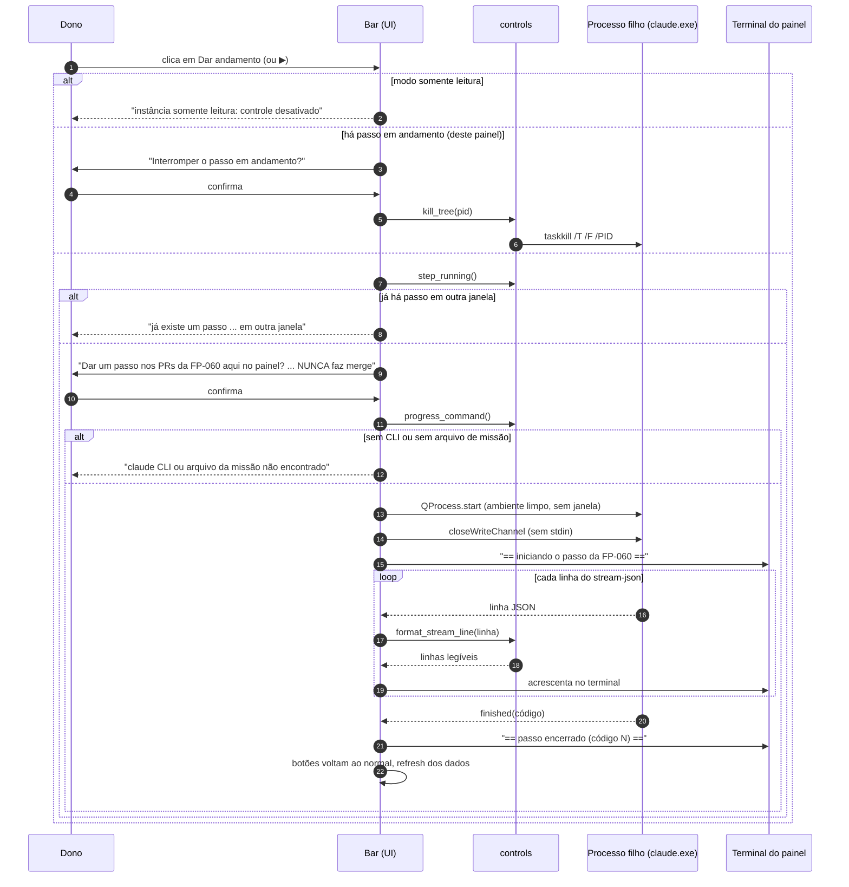
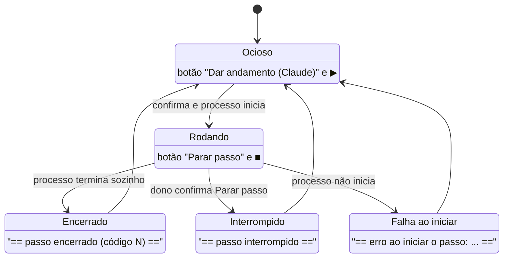

# Passo do Claude ("Dar andamento")

> **Histórico (2026-11-22):** este documento descreve peças do orquestrador legado FP-057/FP-060 (listener/event bridge, laço de revisão do Codex, chip GPT, passo "Dar andamento", `AGENT_BAR_GOV_DIR`) que **saíram** do Agent Bar. O estado atual está no README e em [`docs/audit/legacy-cleanup-2026-11-22.md`](../audit/legacy-cleanup-2026-11-22.md).

O botão **Dar andamento (Claude)** (no painel) e o **▶** (na barra) rodam **um passo**: uma sessão do Claude Code, sem tela (`claude -p`), que lê um arquivo de **missão** e executa o que ele manda. O progresso aparece num **terminal embutido, somente leitura**, dentro do painel, e há um botão **Parar passo** (■). A barra **não faz merge e não decide nada**: o que o passo pode ou não fazer é definido pela missão e pelo sistema de permissões do Claude.

## Fluxo completo



## Pré-condições e recusas (nesta ordem)

| # | Condição | Resultado |
| --- | --- | --- |
| 1 | `AGENT_BAR_OBSERVE_ONLY=1` | recusa: "instância FP-061 somente leitura: controle desativado" |
| 2 | já há um passo **deste painel** | o botão vira **Parar passo**: pede confirmação e interrompe |
| 3 | há outro `claude`/`node` com `fp060-passo.md` na linha de comando (outra janela) | recusa: "já existe um passo da FP-060 rodando em outra janela: feche-o antes de iniciar outro" |
| 4 | o dono não confirma | nada acontece (nem monta o comando) |
| 5 | `claude` fora do PATH **ou** arquivo da missão inexistente | recusa: "claude CLI ou arquivo da missão não encontrado (veja AGENT_BAR_MISSION)" |

A checagem 3 é **conveniência** (evita dois passos simultâneos), não barreira de segurança: se a tabela de processos estiver indisponível, ela não bloqueia.

## O comando exato (`progress_command`)

```
<claude.exe> -p "Leia <MISSÃO> e execute exatamente essa missao: um passo para reduzir os PRs abertos da FP-060, respeitando as regras duras do arquivo."
             --permission-mode auto
             -n "FP-060 passo"
             --output-format stream-json
             --verbose
```

- **Programa:** `shutil.which("claude")`; se existir ao lado dele `node_modules\@anthropic-ai\claude-code\bin\claude.exe`, usa esse executável nativo (o `.cmd` do npm não é um executável direto); senão usa o que o PATH achou.
- **Missão (`<MISSÃO>`):** `AGENT_BAR_MISSION` se definido; senão `<workspace>\ops\launchers\fp060-passo.md`. O arquivo precisa existir.
- **Workspace (cwd do passo):** `AGENT_BAR_WORKSPACE`; senão a primeira pasta acima do pacote que contenha `ops\launchers`; senão o diretório atual.
- **`--permission-mode auto`:** o Claude decide as permissões pelo classificador do modo automático. **A barra não restringe** o que o passo faz além disso (ver [Segurança](../seguranca.md)).
- **Saída `stream-json` + `--verbose`:** um evento JSON por linha, que a barra traduz para texto legível.

### Ambiente do processo filho
- Herda o ambiente da barra **menos** `GH_TOKEN`, `CLAUDECODE` e `CLAUDE_CODE_ENTRYPOINT` (o filho não herda token do GitHub nem o contexto de outra sessão do Claude); acrescenta `PYTHONUTF8=1`.
- No Windows nasce com `CREATE_NO_WINDOW` (nenhum console extra aparece).
- O canal de entrada é fechado logo após o início (`closeWriteChannel`): sem isso o Claude espera ~3 s por dados no stdin.

## Tradução do stream (`format_stream_line`)

| Evento JSON | Vira no terminal |
| --- | --- |
| `system` com `subtype: init` | `== sessao iniciada ==` |
| `assistant` com bloco `text` | o texto do bloco (sem espaços nas pontas) |
| `assistant` com bloco `tool_use` | `  > <Ferramenta>: <resumo>`; o resumo é o primeiro campo presente entre `command`, `file_path`, `pattern`, `path`, `description`, `url` (espaços colapsados, até 130 caracteres), ou o JSON do input cortado em 130 |
| `result` | `== FIM (ok ou ERRO, Ns, turnos N) ==` e, se houver, o texto do resultado |
| linha que não é JSON (ou JSON que não é objeto) | a própria linha, sem alteração |
| qualquer outro evento (por exemplo, `user`) | ignorado (não polui o terminal) |
| linha vazia | ignorada |

O terminal guarda no máximo **500 linhas** (as mais antigas saem) e rola automaticamente para o fim.

## Estados do botão e do terminal



Ao terminar (qualquer desfecho) a barra: restaura os botões, mostra "passo terminado" na linha de status e pede um `refresh` forçado para os dados refletirem o que o passo fez nos PRs. O terminal **fica visível** com o histórico até o painel ser fechado/recriado.

## Parar o passo

- Pede confirmação: "Interromper o passo em andamento? O que ele já publicou nos PRs continua lá."
- `kill_tree(pid)`: `taskkill /T /F /PID <pid>` do **processo que o painel iniciou** (e dos filhos dele). **Por PID, nunca por nome de imagem.** Se o `taskkill` falhar, usa `QProcess.kill()`.
- O que o passo **já publicou** (commits enviados, comentários) **não é desfeito**: parar interrompe o processo, não reverte efeitos.
- Encerrar a barra (`Encerrar barra`) também encerra o passo em andamento (não deixa processo órfão).

## Como o passo aparece nos estados

Enquanto o passo roda, a linha de comando dele contém `fp060-passo.md`. O coletor do Claude reconhece isso e mostra o chip **Claude** como **trabalhando** ("Passo FP-060 (botão)") com o logo animado. Detalhes em [Estados dos agentes](estados-dos-agentes.md#claude-collect_claude).

## Limites

- **Não é um terminal interativo:** você acompanha e pode parar, mas não digita. O modo sem tela é deliberado ([ADR 0005](../adr/0005-passo-sem-tela-com-terminal-embutido-somente-leitura.md)).
- **Um passo por vez** (deste painel; e a barra recusa se vê outro em outra janela).
- A **missão é entrada confiável**: a barra não valida o conteúdo. Quem controla `AGENT_BAR_MISSION` controla o que o passo faz.
- O texto do botão e o prompt falam em "FP-060" porque a missão padrão pertence a esse projeto; com `AGENT_BAR_MISSION` a missão pode ser outra, mas o prompt de abertura continua o mesmo.
