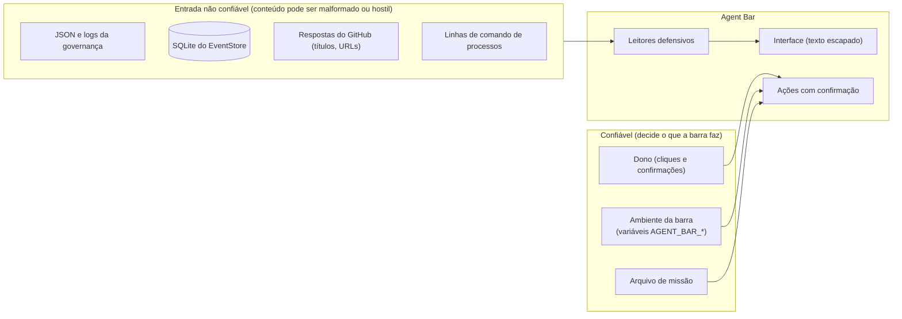

# Segurança

O Agent Bar roda na sua conta, enxerga processos, logs e o estado de uma orquestração, e **pode** iniciar um processo (o passo do Claude). Esta página registra o modelo de ameaça, cada proteção (com o teste que a sustenta) e os **riscos que permanecem**.

## O que a barra faz e não faz

| Faz | Não faz |
| --- | --- |
| lê processos, arquivos de estado, um SQLite (somente leitura), `gh` e o status de login do Claude/Codex | merge, push, commit, criar/fechar PR, alterar branch protection |
| abre links `https://github.com/` e logs | usar `--execute` ou ligar execução automática |
| copia o diagnóstico para a área de transferência | gravar na pasta de governança, em bancos, em logs ou em repositórios |
| (confirmado) para/reinicia o listener **em DRY_RUN** pela Tarefa Agendada | matar processo **por nome** |
| (confirmado) roda **um** passo do Claude e o encerra por PID | guardar, ler ou exibir tokens |
| grava só o `settings.json` (preferências) | telemetria ou chamadas de rede próprias (a rede é do `gh` e do navegador) |

## Fronteiras de confiança

Regra: **tudo o que vem de fora é tratado como dado**, nunca como instrução; e **toda ação com efeito parte de um clique do dono**.

## Proteções, uma a uma

| # | Proteção | Onde | Teste que a sustenta |
| --- | --- | --- | --- |
| 1 | `gh` roda **sem** `GH_TOKEN`/`GITHUB_TOKEN` no ambiente: usa o login guardado pelo próprio `gh` | `run_gh` | `test_snapshot_end_to_end_with_fakes_and_diagnostic_has_no_secrets` (o diagnóstico não contém segredos) |
| 2 | Logins (`claude auth status`, `codex login status`) e o passo rodam sem `CLAUDECODE`, `CLAUDE_CODE_ENTRYPOINT` e `GH_TOKEN` | `_run_cli`, `Bar.start_step` | `test_progress_button_runs_the_step_inside_the_panel_and_streams_the_output` |
| 3 | Linhas de comando exibidas têm tokens conhecidos mascarados (`ghp_…`, `github_pat_…`, `sk-…`, `Bearer …`) e são cortadas | `short_cmd` | `test_snapshot_end_to_end_with_fakes_and_diagnostic_has_no_secrets` |
| 4 | Leitura de logs limitada em bytes e contida na pasta do banco (nada fora dela) | `_safe_tail` | `test_terminal_path_outside_fixture_root_is_rejected` |
| 5 | EventStore aberto `mode=ro` + `query_only`; nunca cria banco, tabela nem WAL | `collect_observation` | `test_read_only_projection_uses_existing_store_and_bounded_log`, `test_missing_and_incompatible_store_never_create_or_claim_healthy` |
| 6 | Só abre URLs `https://github.com/` (botões e links da fila de PRs) | `open_url`, `queue_html` | `test_open_url_only_accepts_github`, `test_pr_links_are_rendered_only_for_github_urls` |
| 7 | Todo texto externo é escapado antes de entrar em rótulos de texto rico (HTML) | `esc`, `_clean` | `test_full_view_renders_observed_facts_and_unavailable_channels` |
| 8 | Toda ação com efeito exige **confirmação**; sem ela, nada é consultado nem executado | `Bar.confirm`, controles | `test_both_controls_require_confirmation_and_touch_nothing_without_it`, `test_a_declined_confirmation_starts_nothing`, `test_buttons_stop_and_restart_do_nothing_without_confirmation` |
| 9 | **Preflight único e fail-closed** de parar/reiniciar: kill switch, tarefa com `-Execute`, ação ilegível, processos indisponíveis e execução ativa recusam | `controls.preflight` | `test_stop_and_restart_share_one_fail_closed_preflight`, `test_kill_switch_blocks_both_controls_and_nothing_is_even_queried` |
| 10 | Parar/reiniciar só usa a **Tarefa Agendada** e **prova** que o executor sumiu; nunca cria 2ª instância | `stop_listener`, `restart_listener_dry_run` | `test_stop_uses_only_the_scheduled_task_never_taskkill_by_name_and_proves_the_executor_is_gone`, `test_restart_does_not_start_a_second_instance_if_the_old_one_is_still_alive` |
| 11 | O código **não contém** `git push`, `git commit`, `taskkill /IM`, `Stop-Process`, `gh pr merge`, `--execute` | todos os módulos | `test_no_module_of_the_bar_can_commit_push_merge_or_kill_by_image_name` |
| 12 | O **único** lançamento do Claude é o passo confirmado, e o encerramento é **só por PID** (`taskkill /T /F /PID`, nunca `/IM`) | `progress_command`, `kill_tree` | `test_the_only_claude_launch_is_the_confirmed_progress_step_and_it_is_stopped_by_pid_only` |
| 13 | Nenhum subprocesso da barra abre janela de console | `NO_WINDOW` | `test_every_subprocess_of_the_bar_is_created_without_a_console_window` |
| 14 | Modo somente leitura desativa todos os controles | `AGENT_BAR_OBSERVE_ONLY` | `test_observe_only_guards_legacy_control_actions`, `test_progress_button_is_disabled_in_the_read_only_instance`, `test_the_play_button_is_disabled_in_the_read_only_instance` |
| 15 | Falha de leitura vira erro explícito, nunca verde nem zero | coletores | `test_pr_queue_failure_is_an_explicit_error_never_an_empty_list`, `test_corrupted_state_or_log_is_never_green`, `test_process_table_unavailable_is_gray` |
| 16 | Configuração corrompida não derruba nem vira valor perigoso (faixas limitadas) | `settings.clamp/load` | `test_settings_roundtrip_clamp_and_corrupt_file` |
| 17 | A UI nunca cai por erro de coleta | `Worker._loop` | `test_a_control_that_raises_is_reported_as_failure` (controles) |

## Riscos que permanecem (e o que fazer)

| Risco | Por que existe | Mitigação atual | Recomendação |
| --- | --- | --- | --- |
| **O passo roda o Claude em `--permission-mode auto` com as suas credenciais** | é o propósito do botão; o que ele pode fazer (inclusive `git push`) depende da missão e do classificador do Claude, **não** da barra | clique + confirmação; botão **Parar passo**; a barra nunca passa token do GitHub | mantenha regras duras no arquivo de missão (por exemplo, "nunca fazer merge") e revise o conteúdo dela |
| **A missão é entrada confiável** | `AGENT_BAR_MISSION` pode apontar qualquer `.md` | a barra só confere que o arquivo existe | proteja o ambiente em que a barra é iniciada (quem controla o ambiente controla a missão) |
| **Linhas de comando podem conter segredos de formato desconhecido** | o mascaramento é por padrões conhecidos | `short_cmd` cobre `ghp_`, `github_pat_`, `sk-`, `Bearer` | não passe segredos por argumentos de processo |
| **`taskkill /F` é abrupto** | interromper o passo não permite limpeza | só o PID do passo e filhos | o que o passo já publicou **não é desfeito** |
| **Diagnóstico na área de transferência** | qualquer app pode ler | só estado observado, sem segredos | cole em lugar confiável |
| **Repositório alvo fixo** (`GFCDOTA/sketchup-mcp`) | acoplamento herdado da extração | leitura apenas | ver [roadmap](limitacoes-e-roadmap.md) |
| **Repositório público** | o código e as capturas de demonstração são públicos | capturas são de fixture rotulada; varredura de segredos/dados pessoais antes de publicar | nunca commitar segredos, e-mail, caminhos pessoais ou capturas de produção |

## Princípios que guiam as decisões de segurança
1. **Fail-closed:** na dúvida, recusa e diz o motivo ([ADR 0001](adr/0001-somente-observacao-com-uma-unica-acao.md), [ADR 0008](adr/0008-ausencia-de-dado-nunca-e-sucesso.md)).
2. **Mínimo privilégio:** a barra não precisa de administrador; o `gh` usa o login existente; o SQLite é aberto só para leitura.
3. **Uma ação, bem delimitada:** o passo do Claude é a única ação "viva", sempre confirmada e com botão de parada ([ADR 0005](adr/0005-passo-sem-tela-com-terminal-embutido-somente-leitura.md)).
4. **Dado externo é dado:** escapado, limitado e contido.
