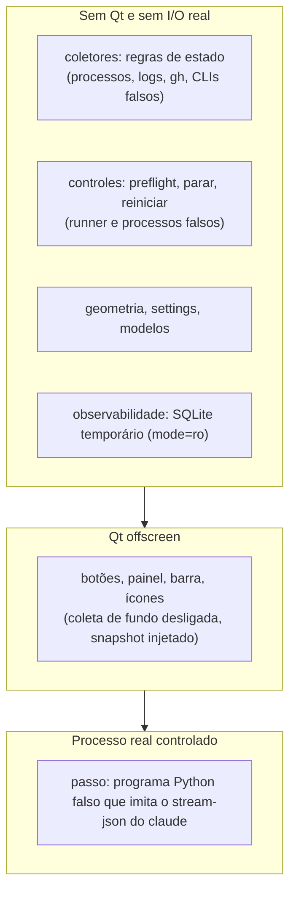

# Testes

> **Histórico (2026-11-22):** este documento descreve peças do orquestrador legado FP-057/FP-060 (listener/event bridge, laço de revisão do Codex, chip GPT, passo "Dar andamento", `AGENT_BAR_GOV_DIR`) que **saíram** do Agent Bar. O estado atual está no README e em [`docs/audit/legacy-cleanup-2026-11-22.md`](audit/legacy-cleanup-2026-11-22.md).

**145 testes**, todos rodam **sem Windows real, sem rede e sem Qt visível** (Qt em modo `offscreen`; o resto por funções injetadas). A suíte inteira leva cerca de 3 minutos (os testes de GUI e de processo real dominam o tempo).

```powershell
.venv\Scripts\pip install -e .[dev]
$env:QT_QPA_PLATFORM = "offscreen"
.venv\Scripts\python -m pytest -q
.venv\Scripts\python -m ruff check .
```

## Estratégia



Princípios da suíte:
- **Todo I/O externo entra por função injetável** (`procs_fn`, `gh`, `run`, `which`, `clock`...), então os testes controlam o "mundo".
- **Nunca mockar o que não é nosso:** o SQLite é real (arquivo temporário); o processo do passo é um processo real (um `python -c` que imprime eventos), só o `claude` é trocado.
- **Determinismo:** relógios injetados; nada de `sleep` fixo (os testes de GUI esperam por condição, com limite).
- **Cada garantia de segurança tem um teste** (ver a tabela em [Segurança](seguranca.md)).

## Fixtures e helpers (em `tests/`)

| Nome | Para quê |
| --- | --- |
| `gui` | cria a `Bar` em modo offscreen, **sem** coleta de fundo, e a entrega com `QApplication` e uma pasta temporária |
| `snap(tmp)` | monta um `Snapshot` real a partir de fakes (processos, gh offline) |
| `wait_for(app, cond, secs)` | processa eventos Qt até a condição ou o limite |
| `fixture_store` | cria um SQLite do EventStore temporário (com `tests/support/event_store.py`) |
| `_stream_program(*eventos, sleep=)` | programa falso que imprime eventos `stream-json` e (opcional) fica vivo |
| `no_external_step` | desliga a detecção de "passo em outra janela" |
| `tests/fixtures/fp061_visual.py` | script que gera as capturas de demonstração (fixture rotulada) |

## Mapa: o que cada grupo garante

### `tests/test_agent_bar.py` (82)

| Grupo | Testes (resumo) | Garante |
| --- | --- | --- |
| Listener | `test_listener_*`, `test_task_running_without_process_is_red`, `test_stale_heartbeat_is_red`, `test_two_concurrent_executors...`, `test_kill_switch_is_yellow...`, `test_corrupted_state_or_log_is_never_green`, `test_bridge_and_log_disagreeing...`, `test_process_table_unavailable_is_gray` | cada linha da tabela de estados do Listener, e que estado ilegível/ausente **nunca** é verde |
| Claude | `test_claude_*` (executando, não atribuído, sem orquestrador, passo do botão, sessão interativa, **login**) | a árvore de decisão do Claude, inclusive login `True`/`False`/`None`, sessão do botão e prioridade do filho do executor |
| Codex | `test_codex_*` (não integrado, análise manual, vinculado, wrapper node, registro `failed`/`done`, app aberto, login, **limite de uso**) | a árvore do Codex e que o app aberto **não** é trabalho |
| GitHub | `test_github_*` | indisponível, verde/pendente/falha, "pede mudanças" não é verde, cache evita consultas repetidas |
| Laço de revisão e login | `test_the_review_loop_process_is_found_and_marks_the_automation_green`, `test_cli_login_state_is_read_from_the_cli_and_cached` | reconhecimento do laço (e vínculo do Codex filho) e o cache de login (300 s / 30 s) |
| Backlog | `test_backlog_*`, `test_snapshot_keeps_the_last_good_backlog...` | contagens, paginação, recusa de contagem incompleta, erro específico, última leitura boa |
| Eventos | `test_repeated_dry_run_events_are_grouped...`, `test_event_grouping_keeps_distinct_reviews_apart` | agrupamento sem spam |
| Processos | `test_process_helpers_find_roots_and_descendants_only`, `test_lock_is_correlated...`, `test_desktop_helpers_and_interactive_sessions...` | raízes, descendentes, auxiliares do app Desktop |
| Controles | `test_both_controls_require_confirmation...`, `test_stop_and_restart_share_one_fail_closed_preflight[...]`, `test_kill_switch_blocks_both_controls...`, `test_stop_*`, `test_restart_*`, `test_failed_*_command_is_reported...` | confirmação, preflight, prova de parada, nenhuma 2ª instância, erros reais reportados |
| Guardas de segurança | `test_open_url_only_accepts_github`, `test_no_module_of_the_bar_can_commit_push_merge_or_kill_by_image_name`, `test_the_only_claude_launch_is_...` | as proibições de código ([Segurança](seguranca.md)) |
| GUI e botões | `test_gui_is_frameless_topmost_with_five_status_icons_and_a_play_button`, `test_button_*`, `test_a_control_that_raises_is_reported_as_failure`, `test_panel_is_compact...`, `test_every_subprocess_of_the_bar_is_created_without_a_console_window` | janela sem moldura/topo, cada botão faz exatamente o que diz e relata falha de verdade |
| Configuração | `test_settings_roundtrip_clamp_and_corrupt_file` | faixas, arquivo corrompido |

### `tests/test_agent_bar_panel.py` (28)

| Grupo | Garante |
| --- | --- |
| Geometria pura (`test_clamp_*`, `test_pick_screen...`, `test_fit_height...`, `test_place_below...`) | limites, monitor com origem negativa, janela maior que a área, escolha do monitor, painel abaixo/acima |
| DPI (`test_dpi_scales...[1.0, 1.25, 1.5, 2.0]`) | o painel sempre cabe em escalas diferentes |
| Barra de título e painel (`test_titlebar_*`, `test_close_x_*`, `test_minimize_*`, `test_square_button_*`, `test_esc_*`, `test_close_panel_and_end_bar_are_distinct_actions`) | cada botão do painel e que fechar o painel **não** encerra a barra nem a coleta |
| Arrasto e acompanhamento (`test_dragging_the_titlebar_*`, `test_panel_follows_the_bar_*`, `test_drag_beyond_the_screen_edges...`, `test_opening_near_the_bottom_right_corner...`) | independência do painel, limites em todos os lados e multi-monitor |
| Rolagem (`test_many_events_scroll_inside...`, `test_a_snapshot_arriving_while_closed...`) | título e botões sempre acessíveis; snapshot não reabre painel fechado |
| **Barra sobre a barra de tarefas** (`test_the_bar_can_be_dragged_down_over_the_taskbar...`, `test_a_saved_position_over_the_taskbar...`, `test_when_the_monitor_changes...`, `test_the_bar_and_the_open_panel_are_raised_above_the_taskbar_periodically`) | limite = monitor inteiro, posição salva respeitada ou trazida de volta, reposicionamento ao mudar o monitor, topo reafirmado |

### `tests/test_agent_bar_observability.py` (33)

| Grupo | Garante |
| --- | --- |
| EventStore (`test_read_only_projection...`, `test_missing_and_incompatible_store...`, `test_terminal_path_outside_fixture_root...`, `test_demo_is_explicit...`, `test_explicit_coordinator_log_fallback...`) | leitura somente leitura, banco ausente/incompatível sem criar nada, contenção de caminho, rótulo de demonstração, fallback do log do coordenador |
| Painel e Central completa (`test_expanded_and_full_modes...`, `test_full_view_renders...`, `test_observe_only_guards...`) | mesmos dados nos dois modos; canais inexistentes dizem "indisponível" |
| Fila de PRs (`test_each_open_pr_is_classified...`, `test_a_pr_without_any_check_rollup...`, `test_pr_queue_failure...`, `test_pr_queue_follows_pagination...`, `test_panel_shows_the_pr_queue...`, `test_panel_shows_the_queue_error...`, `test_pr_links_are_rendered_only_for_github_urls`) | classificação, paginação, erros explícitos, links só do GitHub |
| Passo do Claude (`test_stream_lines...`, `test_progress_command...`, `test_workspace_root...`, `test_step_running...`, `test_progress_button_runs_the_step_inside_the_panel...`, `test_a_declined_confirmation...`, `test_the_stop_button_ends_only_the_step_it_started`, `test_a_step_already_running...`, `test_a_missing_claude_cli...`, `test_progress_button_is_disabled...`) | tradução do stream, comando, execução real de um processo falso, parada **por PID** (confere que o PID morreu), recusas |
| Ícones e ▶ (`test_idle_agents_show_a_colored_dot...`, `test_each_agent_has_its_own_logo_painter...`, `test_the_bar_has_a_play_button...`, `test_the_play_button_is_disabled...`, `test_the_panel_explains_the_colors...`) | bolinha vs. logo, animação só quando há trabalho, sincronia ▶/■ com o painel, legenda |

### `tests/test_standalone_layout.py` (2)
`default_gov_dir` fica **dentro deste repositório** quando não configurado e respeita `AGENT_BAR_GOV_DIR` (defeito real corrigido na extração).

## Evidência visual

`tests/fixtures/fp061_visual.py` gera as capturas de `docs/reports/fp061/` com um SQLite temporário e `AGENT_BAR_DEMO=1` (rótulo **DEMONSTRAÇÃO**), sem coleta de processos nem rede. **Captura offscreen prova layout, não o resultado em um desktop Windows real**; a validação visual em desktop é do dono do projeto.

## O que os testes **não** cobrem (honestidade)
- O comportamento real do `claude`/`codex`/`gh` reais (são substituídos por fakes; o passo real foi verificado manualmente com um pedido inofensivo).
- A aparência em monitores/escalas reais (a geometria é testada com retângulos e escalas simuladas).
- Windows Terminal, tarefa agendada e processos reais do orquestrador.
- Há um teste de dois processos reais no projeto de origem que é sensível a carga; aqui os processos reais são só o programa falso do passo.
